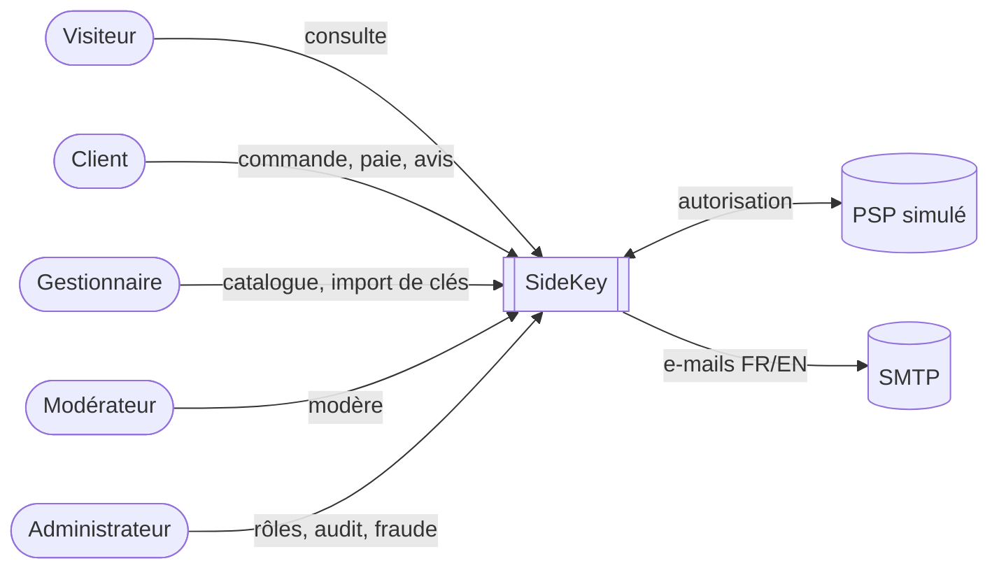
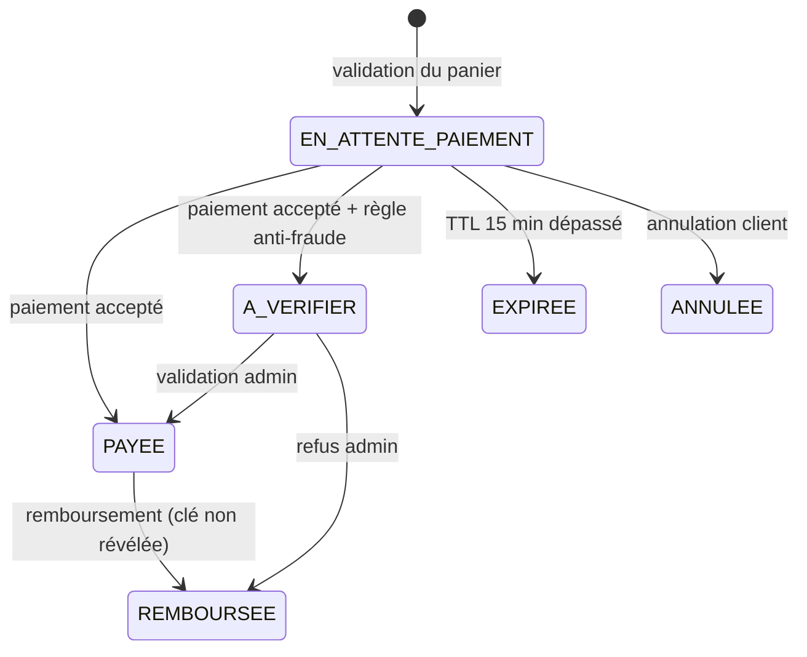
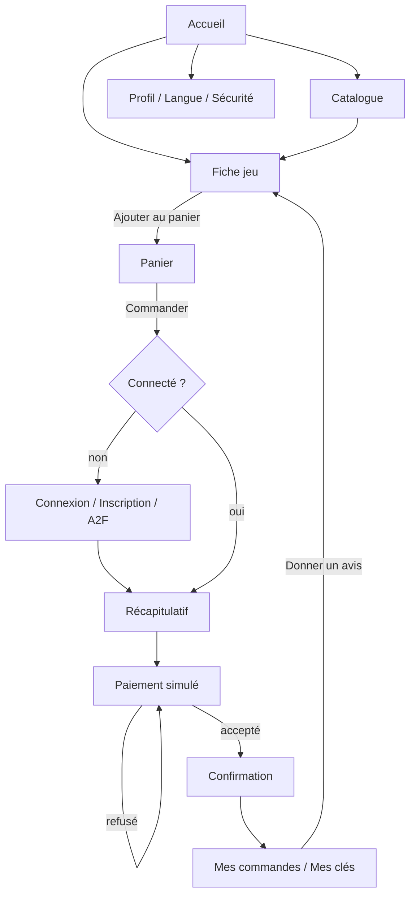
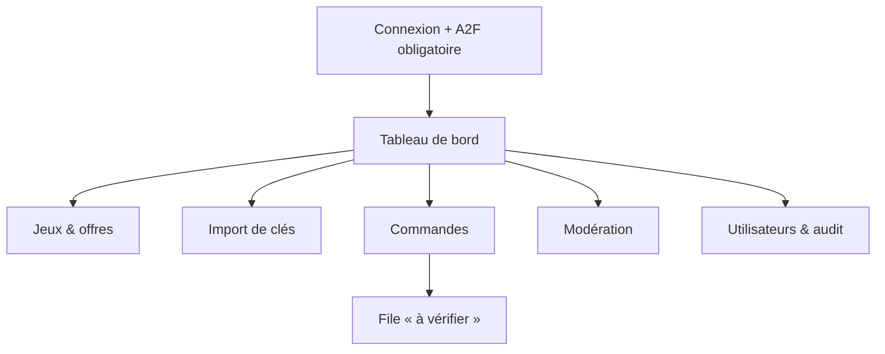
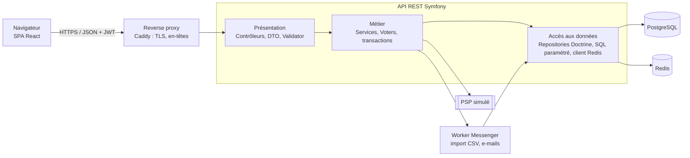
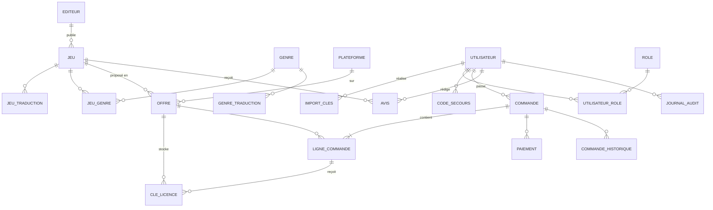
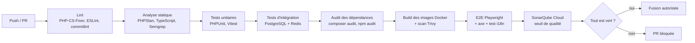

# Cahier des charges — v1.2
## « SideKey » : boutique en ligne de clés de licence de jeux vidéo

| Élément | Valeur |
|---|---|
| Projet | **SideKey** |
| Contexte | Projet de formation en binôme — Titre professionnel CDA (REAC TP-01281 v04 du 24/05/2023) |
| Blocs visés | **Activité type 2** — Concevoir et développer une application sécurisée organisée en couches · **Activité type 3** (partie DevOps : CI/CD) |
| Version | 1.2 — intègre les décisions de cadrage et de conception du binôme du 23/11/2026 (deux séries) |
| Date | 23/11/2026 |
| Durée | **2 à 3 semaines**, soutenances orales des groupes en semaine 3 |
| Auteurs | [Prénom NOM 1] · [Prénom NOM 2] |

> **Règle directrice (choix du binôme, conforme au REAC)** : chaque outil et chaque technologie doit être **justifié par un besoin identifié**, exprimé par un **persona** (§3). La matrice de justification est au §8.

> Les éléments marqués **[À valider]** restent à trancher. La liste complète est au §19.

---

## Sommaire

0. [Journal des décisions](#0-journal-des-décisions)
1. [Présentation du projet](#1-présentation-du-projet)
2. [Correspondance avec le REAC](#2-correspondance-avec-le-reac)
3. [Personas](#3-personas)
4. [Acteurs et limites du système](#4-acteurs-et-limites-du-système)
5. [Besoins fonctionnels](#5-besoins-fonctionnels)
6. [Règles de gestion](#6-règles-de-gestion)
7. [Maquettes et enchaînement des écrans](#7-maquettes-et-enchaînement-des-écrans)
8. [Architecture et justification de la stack](#8-architecture-et-justification-de-la-stack)
9. [Données : base relationnelle et NoSQL](#9-données--base-relationnelle-et-nosql)
10. [Gestion des conflits d'accès et des transactions](#10-gestion-des-conflits-daccès-et-des-transactions)
11. [Sécurité](#11-sécurité)
12. [Conformité : RGPD, RGAA, éco-conception, multilingue](#12-conformité--rgpd-rgaa-éco-conception-multilingue)
13. [Exigences non fonctionnelles et cibles qualité](#13-exigences-non-fonctionnelles-et-cibles-qualité)
14. [Stratégie de tests](#14-stratégie-de-tests)
15. [DevOps : CI/CD et déploiement](#15-devops--cicd-et-déploiement)
16. [Organisation du projet](#16-organisation-du-projet)
17. [Livrables](#17-livrables)
18. [Hors périmètre v1](#18-hors-périmètre-v1)
19. [Points restant à valider](#19-points-restant-à-valider)
20. [Glossaire](#20-glossaire)

---

## 0. Journal des décisions

### 0.1 Décisions de cadrage (prises par le binôme selon le REAC)
| # | Sujet | Décision | Impact dans le document |
|---|---|---|---|
| F1 | Sujet et périmètre pour l'activité type 2 | ✅ SideKey couvre les compétences de l'activité type 2 (grille du §2) | §2 |
| F2 | Organisation en binôme | ✅ Gestion du projet **par feature** | §16.3 |
| F3 | Produits vendus | ✅ **Clés de licence uniquement** (pas d'occasion) | Stock physique, adresses, expédition et frais de port supprimés |
| F4 | NoSQL | ✅ **PostgreSQL (SQL) + Redis (NoSQL clé/valeur)**, conformément au « format clé/valeur » cité par le REAC ; MongoDB n'était qu'une option | §9.8, confirmé par R1 |
| F5 | Activité type 3 | ✅ **CI/CD à prévoir** (partie DevOps) | Nouveau §15 |
| F6 | Justification des choix techniques | ✅ **Chaque outil est justifié** par un besoin exprimé par des **personas fictifs** ou par un attendu du REAC | Nouveaux §3 et §8.3 |
| F7 | Rythme | ✅ **Sprints journaliers** | §16.1, §16.4 |
| F8 | Rôle du PO / client | ✅ Porté par le binôme ; les personas servent de voix de l'utilisateur | §16.1 |
| F9 | Livrables officiels | ✅ **Dossier de projet, projet (code), diaporama** | §17 |
| F10 | Langues | ✅ **Application multilingue FR + EN uniquement** | §12.4 |
| F11 | Exigences RGAA et éco-conception | ✅ Intégrées au projet (attendus du REAC, compétences 5 et 6) | §12 |
| F12 | Paiement simulé | ✅ Paiement **simulé** en v1, **justifié** au §11.6 | §11.6 |

### 0.2 Décisions du binôme
| # | Sujet | Décision | Impact |
|---|---|---|---|
| B1 | Stack | ✅ **Symfony + React**, justifiés par les personas | §8.3 |
| B2 | Authentification | ✅ **JWT**, justifié par les personas | §11.4 |
| B3 | CSRF | ✅ Découle du JWT (justifié) | §11.4 |
| B4 | Outils | ✅ **GitHub** (dépôt), **GitHub Actions** (CI/CD), **GitHub Projects** (backlog) | §15, §16.2 |
| B5 | Modélisation | ✅ **PlantUML** et **Figma** | §16.2 |
| B6 | Répartition des features | ⏳ À définir (proposition au §16.3) | §19 |
| B7 | Seuils anti-fraude | ⏳ Détails demandés pour choisir → **comparatif au §6.3** | §19 |
| B8 | Durées et TTL | ✅ Validés (réservation 15 min, panier 7 j / 24 h, cache 5 min) | §9.8 |
| B9 | Mots de passe | ✅ Politique sécurisée **+ authentification à deux facteurs (A2F) possible** | §11.4 |
| B10 | Durées de conservation | ✅ **Selon le RGPD** (normes européennes), précisées avec les obligations françaises | §12.1 |
| B11 | Cibles qualité | ✅ **Ensemble complet** intégré à la chaîne DevOps | §13, §15 |
| B12 | Conventions Git | ✅ Conventions de commit et gestion du dépôt **selon les recommandations** | §16.5 |
| — | Frais de port | 🗑️ Sans objet (clés uniquement) | — |

### 0.3 Décisions de la deuxième série (v1.2)
| # | Sujet | Décision | Impact |
|---|---|---|---|
| R1 | NoSQL | ✅ **Redis seul**, comme proposé | §9.8 |
| R3 | Anti-fraude | ✅ Niveau **Équilibré** | §6.3 |
| R2 | Répartition | ✅ La répartition proposée convient, mais elle doit **évoluer selon l'avancement**. On liste **toutes** les features : les **prioritaires sont attribuées dès le départ**, les **moins importantes sont attribuées manuellement** au fil de l'avancement. | §16.3 |
| R4 | Hébergement | ✅ **Hébergement dans l'UE** | §8.3, §15 |
| R5 | Durée | ✅ **Environ 2 à 3 semaines**, soutenances orales en semaine 3 | Planning §16.4 refait ; périmètre recentré sur les features M |

---

## 1. Présentation du projet

### 1.1 Contexte
SideKey est une boutique en ligne **fictive** qui vend des **clés de licence numériques** de jeux vidéo (Steam, PlayStation Store, Xbox, Nintendo eShop…). Les clés sont livrées instantanément dans l'espace client après paiement.

Le projet reprend les mécanismes d'un e-commerce (catalogue, panier, tunnel de commande, back-office), avec une contrainte forte : **une clé de licence est un bien unique et sensible**. Elle ne doit jamais être vendue deux fois, ni fuiter.

### 1.2 Objectifs
| # | Objectif | Indicateur de réussite |
|---|---|---|
| O1 | Acheter un jeu en moins de 5 écrans | Tunnel complet : catalogue → fiche → panier → paiement → confirmation |
| O2 | Garantir qu'une clé n'est attribuée qu'à une seule commande | 0 doublon au test de concurrence (§14) |
| O3 | Protéger les clés et les données personnelles | Clés chiffrées, A2F pour le back-office, tests OWASP passés |
| O4 | Outiller les gestionnaires | Back-office : catalogue, import de clés, commandes, modération |
| O5 | Offrir une application bilingue FR / EN | 100 % des libellés traduits |
| O6 | Livrer en continu de façon fiable | Pipeline CI/CD vert ; déploiement automatisé en recette |
| O7 | Démontrer les compétences de l'activité type 2 (et la partie DevOps de l'activité type 3) | Grille du §2 couverte |

### 1.3 Périmètre v1
Inclus : catalogue, recherche et filtres, fiche jeu, panier, compte client (avec A2F facultative), commande, **paiement simulé**, livraison des clés dans l'espace client, avis, back-office (catalogue, import de clés, commandes, modération, rôles, audit), interface **FR / EN**, **CI/CD**.
Exclus : voir §18.

---

## 2. Correspondance avec le REAC

### Compétence 5 — Analyser les besoins et maquetter une application
| Critère / savoir-faire du REAC | Réponse | § |
|---|---|---|
| Les besoins couvrent l'ensemble des exigences | Personas → user stories MoSCoW avec critères d'acceptation | §3, §5 |
| Limites du système, acteurs, messages | Diagramme de contexte, cas d'utilisation | §4 |
| Maquettes conformes, en français et en anglais (B1) | Maquettes Figma **FR et EN** (application bilingue) | §7 |
| Enchaînement formalisé par un schéma | Diagrammes d'enchaînement | §7.2, §7.3 |
| RGAA, RGPD, ergonomie, éco-conception | Exigences dédiées | §12 |
| Dossier de conception structuré | Intégré au dossier de projet | §17 |

### Compétence 6 — Définir l'architecture logicielle
| Critère / savoir-faire du REAC | Réponse | § |
|---|---|---|
| Architecture multicouche répartie sécurisée | SPA React ↔ API REST Symfony (contrôleur / service / repository) ↔ PostgreSQL + Redis | §8.1 |
| Rôle de chaque couche selon la stratégie de sécurité | Tableau couche → contrôles | §8.2 |
| Frameworks et ORM identifiés **et justifiés** | Matrice besoin → persona → techno | §8.3 |
| Design patterns et security patterns | §8.5 | §8.5 |
| DICP, ANSSI | §11.1 | §11.1 |
| Éco-conception | §12.3 | §12.3 |

### Compétence 7 — Concevoir et mettre en place une base de données relationnelle
| Critère | Réponse | § |
|---|---|---|
| Schéma conceptuel conforme au relationnel | MCD en 3FN (PlantUML) | §9.2 |
| Schéma physique et nommage | MPD PostgreSQL, convention | §9.1, §9.3 |
| Intégrité, sécurité, confidentialité | Contraintes, chiffrement, rôles SGBD | §9.4, §9.5 |
| Base de test avec jeu d'essai, restaurable | Seed et sauvegarde / restauration testées | §9.7 |

### Compétence 8 — Développer des composants d'accès aux données SQL et NoSQL
| Critère | Réponse | § |
|---|---|---|
| CRUD conforme au dossier de conception | Repositories Doctrine par agrégat | §8, §9 |
| Cas d'exception | Gestionnaire d'exceptions global, codes HTTP normalisés | §8.2 |
| Conflits d'accès et transactions | `FOR UPDATE SKIP LOCKED`, verrouillage optimiste | §10 |
| Fonctions, procédures, triggers défensifs | PL/pgSQL | §9.6 |
| NoSQL clé/valeur | Redis | §9.8 |
| Entrées contrôlées côté serveur | Symfony Validator sur les DTO | §11.3 |
| Tests unitaires et de sécurité, analyse statique | PHPUnit, PHPStan, Semgrep, ZAP | §14 |
| Démarche de résolution de problème | Procédure d'incident | §14.5 |
| Veille SQL / NoSQL | §16.6 | §16.6 |

### Activité type 3 — partie DevOps (décision F5)
| Attendu | Réponse | § |
|---|---|---|
| Plan de tests | Stratégie de tests, exécutée en CI | §14 |
| Préparer le déploiement | Conteneurs Docker, environnements, procédure de déploiement | §15 |
| Contribuer à la mise en production dans une démarche DevOps | Pipeline GitHub Actions CI/CD, déploiement automatisé, retour arrière | §15 |

---

## 3. Personas

Les personas sont **fictifs**. Chacun exprime des besoins identifiés (`BX-nn`), qui justifient les fonctionnalités et les choix techniques (§8.3).

### P1 — Léa, 23 ans, étudiante et joueuse PC (Saint-Denis, La Réunion)
> « Je veux acheter mes jeux Steam moins cher, depuis mon téléphone, et y jouer tout de suite. Mais j'ai peur des sites louches. »

| ID | Besoin |
|---|---|
| BX-01 | Trouver vite un jeu (recherche, filtres) depuis un **mobile**, même avec une connexion moyenne |
| BX-02 | Recevoir sa clé **immédiatement** après le paiement |
| BX-03 | Avoir **confiance** : site sécurisé, avis d'autres acheteurs, aucune clé vendue en double |
| BX-04 | Un tunnel d'achat court et fluide, sans rechargement de page |

### P2 — Marcus, 34 ans, ingénieur anglophone installé en France, joueur console
> « I don't read French very well. I need the whole store in English, including the e-mails. »

| ID | Besoin |
|---|---|
| BX-05 | Utiliser **toute l'application en anglais** (interface, e-mails, messages d'erreur) |
| BX-06 | Changer de langue à tout moment ; la préférence est mémorisée |
| BX-07 | Protéger son compte, qui contient des clés payées (**A2F**) |

### P3 — Sophie, 46 ans, malvoyante, achète des jeux pour ses enfants
> « J'utilise un lecteur d'écran. Je dois savoir si un jeu convient à l'âge de mes enfants. »

| ID | Besoin |
|---|---|
| BX-08 | Naviguer **au clavier et au lecteur d'écran** (RGAA) |
| BX-09 | Voir clairement la **classification PEGI** et la plateforme |
| BX-10 | Des messages d'erreur compréhensibles, associés aux champs |

### P4 — Karim, 31 ans, gestionnaire catalogue chez SideKey
> « Nos fournisseurs m'envoient des fichiers de milliers de clés. Je dois les importer sans erreur ni doublon. »

| ID | Besoin |
|---|---|
| BX-11 | **Importer des clés en lot** (CSV) avec un rapport (acceptées / doublons / erreurs) |
| BX-12 | Gérer jeux, plateformes et prix ; savoir quand le stock de clés est bas |
| BX-13 | Ne **jamais voir les clés en clair** (pour ne pas être soupçonné en cas de fuite) |
| BX-14 | Ne pas écraser la modification d'un collègue qui édite la même fiche |

### P5 — Nathalie, 49 ans, gérante et administratrice de SideKey
> « Une clé volée, c'est de l'argent perdu. Et je suis responsable des données de mes clients. »

| ID | Besoin |
|---|---|
| BX-15 | Empêcher la **fraude** et le vol de clés (seuils, commandes à vérifier) |
| BX-16 | **Tracer** les actions sensibles : révélation de clés, actions d'administration |
| BX-17 | Respecter le **RGPD** et héberger les données **dans l'Union européenne** |
| BX-18 | Des comptes back-office **fortement protégés** (A2F obligatoire) |
| BX-19 | Pouvoir **restaurer** les données en cas d'incident |

### P6 — Thomas, 27 ans, modérateur à temps partiel
| ID | Besoin |
|---|---|
| BX-20 | Valider ou refuser rapidement les avis, sans accès aux commandes ni aux clés |

### P7 — Hugo, 29 ans, développeur qui reprendra le projet (persona technique)
> « Je dois pouvoir lancer le projet en une commande, comprendre le code et livrer sans peur de tout casser. »

| ID | Besoin |
|---|---|
| BX-21 | Installer l'environnement **en une commande**, identique pour tous |
| BX-22 | Des **tests automatiques** et une **analyse de qualité** à chaque modification |
| BX-23 | Des **déploiements automatisés** et réversibles |
| BX-24 | Un historique Git lisible et une documentation d'API à jour |

---

## 4. Acteurs et limites du système

### 4.1 Acteurs
| Acteur | Persona | Description |
|---|---|---|
| Visiteur | P1, P2, P3 | Navigue sans être connecté |
| Client | P1, P2, P3 | Commande, révèle ses clés, dépose des avis |
| Gestionnaire catalogue | P4 | Jeux, plateformes, prix, import de clés |
| Modérateur | P6 | Modération des avis |
| Administrateur | P5 | Comptes et rôles, audit, commandes suspectes |
| PSP simulé | — | Système externe (bouchon) d'autorisation des paiements |
| Serveur SMTP | — | Envoi des e-mails (Mailpit en développement et en recette) |

### 4.2 Diagramme de contexte



*Tous les diagrammes du dossier de projet seront produits en **PlantUML** (décision B5). Ceux de ce cahier des charges sont en Mermaid uniquement parce que GitHub les affiche directement.*

---

## 5. Besoins fonctionnels

Priorisation **MoSCoW**. La colonne « Besoin » renvoie aux personas du §3.

### 5.1 Catalogue
| ID | User story | Prio | Besoin | Critères d'acceptation |
|---|---|---|---|---|
| US-01 | En tant que visiteur, je veux voir la liste des jeux | M | BX-01 | Liste paginée (20), jaquette, titre, plateformes, prix minimum, disponibilité |
| US-02 | Je veux filtrer par plateforme, genre, prix et PEGI | M | BX-01, BX-09 | Filtres combinables, reflétés dans l'URL |
| US-03 | Je veux rechercher par titre | M | BX-01 | Insensible à la casse et aux accents ; message explicite si aucun résultat |
| US-04 | Je veux consulter une fiche jeu | M | BX-03, BX-09 | Description (FR/EN), éditeur, PEGI, offres par plateforme, stock, note moyenne, avis validés |
| US-05 | Je veux trier par prix, nouveauté ou note | S | BX-01 | |

### 5.2 Panier
| ID | User story | Prio | Besoin | Critères d'acceptation |
|---|---|---|---|---|
| US-10 | Je veux ajouter une offre au panier | M | BX-04 | Panier dans Redis ; TTL 7 j (client) / 24 h (visiteur) |
| US-11 | Je veux modifier les quantités ou retirer un article | M | BX-04 | Quantité bornée par le stock et les seuils anti-fraude (§6.3) |
| US-12 | Je veux retrouver mon panier à la connexion | S | BX-04 | Fusion du panier visiteur avec le panier client |
| US-13 | Je veux voir le total à jour | M | BX-03 | Total calculé côté serveur, à partir des prix en base |

### 5.3 Compte client
| ID | User story | Prio | Besoin | Critères d'acceptation |
|---|---|---|---|---|
| US-20 | Je veux créer un compte | M | BX-03 | E-mail unique, politique de mots de passe (§11.4), consentement, e-mail de vérification dans la langue choisie |
| US-21 | Je veux me connecter et me déconnecter | M | BX-03 | JWT (§11.4) ; limitation de débit ; la déconnexion révoque le jeton de rafraîchissement |
| US-22 | Je veux activer l'A2F (TOTP) | S | BX-07 | QR code, codes de secours, désactivation après re-saisie du mot de passe et d'un code |
| US-23 | Je veux réinitialiser mon mot de passe | S | BX-03 | Jeton à usage unique, 30 min, stocké haché |
| US-24 | Je veux modifier mon profil et ma langue | M | BX-06 | Re-saisie du mot de passe pour changer l'e-mail |
| US-25 | Je veux exporter ou supprimer mes données | S | BX-17 | Export JSON ; suppression = anonymisation (§12.1) |

### 5.4 Commande et paiement
| ID | User story | Prio | Besoin | Critères d'acceptation |
|---|---|---|---|---|
| US-30 | Je veux passer commande | M | BX-04 | Compte vérifié ; récapitulatif ; confirmation de majorité si PEGI 18 |
| US-31 | Je veux que mes clés soient réservées pendant que je paie | M | BX-03 | Réservation de 15 min, puis libération automatique |
| US-32 | Je veux payer par carte (simulée) | M | BX-04 | Aucune donnée de carte stockée ; requête idempotente |
| US-33 | Je veux une confirmation | M | BX-02 | Page et e-mail dans ma langue ; statut `PAYEE` |
| US-34 | Je veux révéler mes clés | M | BX-02, BX-16 | Déchiffrement à la demande, propriétaire uniquement ; révélation journalisée |
| US-35 | Je veux consulter l'historique de mes commandes | M | BX-02 | Liste, détail, statut |
| US-36 | Je veux réessayer après un paiement refusé | M | BX-04 | Réservation conservée jusqu'à la fin du TTL |

### 5.5 Avis
| ID | User story | Prio | Besoin | Critères d'acceptation |
|---|---|---|---|---|
| US-40 | Je veux noter et commenter un jeu acheté | S | BX-03 | Achat payé obligatoire ; un avis par client et par jeu ; langue de l'avis enregistrée |
| US-41 | Je veux modifier ou supprimer mon avis | S | BX-03 | Une modification renvoie l'avis en modération |
| US-42 | En tant que modérateur, je veux valider ou refuser les avis | S | BX-20 | Motif de refus obligatoire |

### 5.6 Back-office
| ID | User story | Prio | Besoin | Critères d'acceptation |
|---|---|---|---|---|
| US-50 | En tant que gestionnaire, je veux gérer jeux, éditeurs, plateformes et genres | M | BX-12 | CRUD, traductions FR/EN, suppression logique |
| US-51 | Je veux gérer les offres (jeu × plateforme, prix) | M | BX-12, BX-14 | Prix > 0 ; verrouillage optimiste (HTTP 409 en cas de conflit) |
| US-52 | Je veux importer des clés en CSV | M | BX-11, BX-13 | Chiffrement à l'import, doublons rejetés, rapport ; synchrone jusqu'à 1 000 lignes en v1 (traitement asynchrone : feature C) |
| US-53 | Je veux une alerte de stock bas | S | BX-12 | Seuil paramétrable par offre |
| US-54 | Je veux suivre les commandes | M | BX-12 | Transitions autorisées uniquement ; historique automatique |
| US-55 | En tant qu'administrateur, je veux gérer les comptes et les rôles | M | BX-18 | A2F obligatoire pour tout rôle back-office |
| US-56 | Je veux traiter les commandes suspectes | M | BX-15 | File « à vérifier » : valider ou annuler (libération des clés) |
| US-57 | Je veux consulter le journal d'audit | S | BX-16 | Filtres, lecture seule |
| US-58 | Je veux un tableau de bord | C | BX-12 | CA, commandes, stock bas |

---

## 6. Règles de gestion

### 6.1 Catalogue et clés
- **RG-01** Une *offre* correspond à un couple jeu × plateforme, avec un prix. Une seule offre active par couple.
- **RG-02** Le stock d'une offre est le nombre de clés au statut `DISPONIBLE`. Il est calculé, jamais saisi à la main.
- **RG-03** Une clé est **unique** dans tout le système (empreinte HMAC unique, §9.4).
- **RG-04** Cycle de vie d'une clé : `DISPONIBLE` → `RESERVEE` → `VENDUE`, ou `RESERVEE` → `DISPONIBLE`. Une clé `VENDUE` ne peut être ni modifiée ni supprimée (trigger).
- **RG-05** Le prix est enregistré dans la ligne de commande au moment de l'achat.

### 6.2 Commande
- **RG-10** Il faut un compte vérifié pour commander.
- **RG-11** Le montant est calculé côté serveur, jamais transmis par le client.
- **RG-12** La réservation dure 15 min (décision B8). Passé ce délai, la commande passe en `EXPIREE` et ses clés sont libérées.
- **RG-13** Les jeux PEGI 18 demandent une confirmation de majorité (déclarative).
- **RG-14** Anti-fraude (niveau Équilibré) : 5 clés au maximum par offre et par commande ; 10 clés au maximum par client sur 24 h glissantes ; 3 échecs de paiement → blocage d'1 h ; commande mise « à vérifier » si le compte a moins de 24 h et le montant dépasse 150 €, ou si la 1re commande dépasse 200 €.

### 6.3 Anti-fraude : niveau **Équilibré** retenu (décision R3)
Trois niveaux ont été comparés, et le binôme a retenu **Équilibré**. Le choix arbitre entre la **fluidité pour Léa (P1)** et la **maîtrise du risque pour Nathalie (P5)**.

| Règle | Souple | **Équilibré ✅ retenu** | Strict |
|---|---|---|---|
| Clés max. par offre et par commande | 10 | **5** | 3 |
| Clés max. par client sur 24 h glissantes | 30 | **10** | 5 |
| Échecs de paiement avant blocage | 5 → blocage 30 min | **3 → blocage 1 h** | 3 → blocage 24 h |
| Commande mise « à vérifier » (clés réservées, non révélables) | Compte < 24 h **et** montant > 300 € | **Compte < 24 h et montant > 150 €, ou 1re commande > 200 €** | Toute 1re commande > 50 € |
| E-mail vérifié avant achat | Oui | **Oui** | Oui |
| A2F client | Facultative | **Facultative** | Obligatoire pour révéler des clés au-delà de 100 € par jour |
| Effet sur Léa (P1) | Très peu de friction | Friction rare, uniquement sur les grosses premières commandes | Friction fréquente : risque d'abandon du panier |
| Effet sur Nathalie (P5) | Risque de revente massive de clés volées par carte | Bloque les schémas courants (compte jetable + gros panier) | Risque très faible, mais plus de vérifications manuelles |
| Charge de travail admin | Très faible | Faible | Élevée |
| Démonstration à la soutenance | Peu de cas à montrer | Tous les cas démontrables avec le jeu d'essai | Tous les cas démontrables |

**Pourquoi « Équilibré »** (justification retenue) : il couvre les fraudes typiques des boutiques de clés (comptes créés à la volée, gros paniers payés avec des cartes volées) sans pénaliser l'usage normal d'une joueuse comme Léa, qui achète 1 à 3 jeux à la fois. Tous les seuils sont **paramétrables** (fichier de configuration Symfony), ce qui permet d'ajuster sans modifier le code.

### 6.4 Statuts de commande



- **RG-20** Une clé révélée n'est plus remboursable.
- **RG-21** Chaque changement de statut est historisé par un trigger.

### 6.5 Avis
- **RG-30** Note de 1 à 5 ; commentaire de 10 à 1 000 caractères ; pas de HTML.
- **RG-31** Un avis par client et par jeu.

---

## 7. Maquettes et enchaînement des écrans

### 7.1 Liste des écrans (tous en FR et en EN)
| Code | Écran | Acteur | Prio |
|---|---|---|---|
| E01 | Accueil | Tous | M |
| E02 | Catalogue | Tous | M |
| E03 | Fiche jeu | Tous | M |
| E04 | Panier | Tous | M |
| E05 | Connexion / inscription / A2F | Visiteur | M |
| E06 | Tunnel 1 : récapitulatif | Client | M |
| E07 | Tunnel 2 : paiement simulé | Client | M |
| E08 | Tunnel 3 : confirmation | Client | M |
| E09 | Mes commandes et mes clés | Client | M |
| E10 | Profil, langue, sécurité (A2F), RGPD | Client | M |
| E11 | Admin : tableau de bord | Back-office | C |
| E12 | Admin : jeux et offres | Gestionnaire | M |
| E13 | Admin : import de clés | Gestionnaire | M |
| E14 | Admin : commandes et file « à vérifier » | Gestionnaire, Admin | M |
| E15 | Admin : modération | Modérateur | M |
| E16 | Admin : utilisateurs, rôles, audit | Admin | M |

Démarche dans **Figma** : wireframes, puis maquettes desktop et mobile (BX-01), puis déclinaison EN. Les maquettes sont validées par une **revue persona** : on parcourt chaque écran avec le scénario d'un persona et sa liste de besoins.

### 7.2 Enchaînement des écrans (front-office)



### 7.3 Enchaînement des écrans (back-office)



---

## 8. Architecture et justification de la stack

### 8.1 Vue d'ensemble (multicouche répartie)



### 8.2 Rôle de chaque couche et contrôles de sécurité
| Couche | Responsabilités | Contrôles de sécurité |
|---|---|---|
| **SPA React** | Affichage, i18n, accessibilité | Échappement natif de JSX ; jeton d'accès **en mémoire** (jamais dans `localStorage`) ; aucun secret côté client |
| **Reverse proxy** | TLS, routage | HTTPS forcé, HSTS, CSP, limitation de taille des requêtes |
| **Présentation** | Routes, désérialisation, codes HTTP | Authentification JWT, **validation des DTO** (Symfony Validator), RateLimiter, gestionnaire d'erreurs sans fuite technique |
| **Métier** | Règles §6, transactions | **Voters** (RBAC et propriété, anti-IDOR), anti-fraude, audit |
| **Accès aux données** | Repositories, appels PL/pgSQL, Redis | Doctrine et requêtes paramétrées, compte SGBD à moindre privilège, chiffrement et déchiffrement des clés |
| **SGBD** | Persistance, intégrité | Contraintes, triggers, rôles, sauvegardes |

### 8.3 Matrice de justification de la stack (décision F6)
Chaque outil répond à au moins un besoin persona (`BX-nn`) ou à un attendu du REAC.

| Couche / besoin | Outil retenu | Besoins couverts | Justification | Alternative écartée et pourquoi |
|---|---|---|---|---|
| Framework back | **Symfony** (dernière LTS au démarrage, 7.4 à date) + PHP 8.3+ | BX-03, BX-15, BX-16, BX-18, BX-22 | Composant **Security** (authentification, Voters RBAC), **Validator**, **RateLimiter**, **Translation**, **Messenger** (asynchrone) intégrés ; architecture en couches naturelle ; LTS = support long | Laravel : plus implicite (façades, Active Record), couches moins visibles pour le jury |
| ORM | **Doctrine ORM** + Doctrine Migrations | BX-03, BX-21, REAC C8 | Data Mapper (repositories séparés des entités : couche d'accès explicite), requêtes paramétrées par défaut, verrouillage optimiste natif (`@Version`, BX-14), migrations versionnées | Requêtes SQL à la main partout : risque d'injection, pas de mapping |
| Front | **React** + **Vite** + TypeScript | BX-01, BX-04, BX-08 | SPA : panier et tunnel sans rechargement (Léa) ; bundle léger avec Vite (mobile, éco-conception) ; TypeScript pour limiter les erreurs | Rendu serveur Twig : tunnel moins fluide, et une API REST serait de toute façon nécessaire pour un futur client mobile |
| Accessibilité front | Composants accessibles (React Aria ou équivalent) + axe | BX-08, BX-10 | Composants conformes ARIA (modales, menus, formulaires) | Composants faits main : risque d'erreurs RGAA |
| i18n | **Symfony Translation** (API, e-mails) + **react-i18next** (SPA) | BX-05, BX-06 | Standards de chaque écosystème ; fichiers de traduction versionnés | Traduction automatique : qualité insuffisante |
| Authentification | **JWT** (LexikJWTAuthenticationBundle) + jeton de rafraîchissement rotatif | BX-03, BX-07, BX-23 | API sans état consommée par une SPA ; passage à l'échelle simple ; réutilisable par une future appli mobile | Session serveur : couplage plus fort au domaine, CSRF à gérer sur toutes les routes |
| A2F | **TOTP** (scheb/2fa-bundle) | BX-07, BX-18 | Standard RFC 6238, compatible avec les applis d'authentification courantes, sans coût d'envoi de SMS | SMS : coûteux, vulnérable au SIM-swap (déconseillé par l'ANSSI) |
| SGBDR | **PostgreSQL** | BX-03, BX-19, REAC C7/C8 | ACID ; `FOR UPDATE SKIP LOCKED` (aucune clé vendue deux fois) ; PL/pgSQL (procédures et triggers exigés par le REAC) ; rôles fins | MySQL : `SKIP LOCKED` disponible, mais rôles et PL moins riches |
| NoSQL clé/valeur | **Redis** | BX-01, BX-04, BX-15, REAC C8 | TTL natif (paniers, réservations 15 min), compteurs atomiques (limitation de débit, anti-fraude), cache catalogue ; correspond au « format clé/valeur » cité par le REAC ; adaptateurs Symfony natifs (Cache, RateLimiter, Lock) | MongoDB : modèle document sans besoin identifié en v1 |
| Asynchrone | **Symfony Messenger** (transport Redis ou Doctrine) | BX-11 | Import de milliers de clés et envoi d'e-mails sans bloquer l'interface | Traitement synchrone : risque de délai d'expiration lors des imports |
| Reverse proxy | **Caddy** | BX-03, BX-17 | HTTPS automatique (Let's Encrypt), configuration courte | Nginx : configuration TLS manuelle, plus verbeuse |
| Conteneurs | **Docker** + Docker Compose | BX-21, BX-23 | Environnement identique en développement, en CI et en production ; une commande pour tout lancer | Installation locale : écarts entre postes |
| Dépôt, backlog, CI/CD | **GitHub**, **GitHub Projects**, **GitHub Actions**, GHCR | BX-22, BX-23, BX-24 | Tout au même endroit : issues ↔ PR ↔ pipeline ↔ images ; gratuit pour le projet | GitLab : équivalent, mais le binôme a choisi GitHub (B4) |
| Qualité | PHPStan, PHP-CS-Fixer, ESLint, SonarQube Cloud, Semgrep | BX-22, REAC C8 | Analyse statique exigée par le REAC ; seuil de qualité bloquant | — |
| Tests | PHPUnit, Vitest + Testing Library, Playwright, k6, OWASP ZAP | BX-03, BX-22 | Unitaires, intégration, bout en bout, concurrence, sécurité (§14) | — |
| Modélisation | **PlantUML** | BX-24 | Diagrammes en texte, versionnés avec le code, relus en PR | Outils graphiques : fichiers binaires non comparables |
| Maquettes | **Figma** | BX-01, BX-05, BX-08 | Maquettes desktop et mobile, variantes FR/EN, prototypage du tunnel | — |
| E-mails de test | Mailpit | BX-22 | Vérifier les e-mails FR/EN sans envoi réel | — |
| Hébergement | ✅ VPS chez un **hébergeur situé dans l'UE** (fournisseur choisi au J3) | BX-17, BX-23 | Données dans l'UE (RGPD) ; déploiement Docker simple | PaaS hors UE : transferts de données à encadrer |

### 8.4 Organisation du dépôt (monorepo)
```
sidekey/
├── api/          # Symfony : src/{Controller,Dto,Service,Repository,Entity,Security,Message}
├── front/        # React + Vite + TS
├── infra/        # docker-compose.*.yml, Caddyfile, scripts backup/restore
├── docs/         # PlantUML, ADR, veille, comptes rendus
└── .github/      # workflows, templates d'issues et de PR, CODEOWNERS, dependabot.yml
```
**Pourquoi un monorepo** : une feature touche à la fois l'API et le front, ce qui donne une seule PR par feature (gestion par feature, décision F2) et une seule pipeline.

### 8.5 Patrons de conception et de sécurité
- **Design patterns** : Repository, DTO / Mapper, Service Layer, **Strategy** (fournisseur de paiement), Factory (commande), Observer / événements Symfony (commande payée → e-mail et audit), Command (messages Messenger).
- **Security patterns** : Authenticator, Authorization Enforcer (Voters), Input Validator, Secure Logger, Encrypted Storage, Limited View, Fail Securely.
- Chaque choix d'architecture important fait l'objet d'un **ADR** (*Architecture Decision Record*) dans `docs/adr/`.

---

## 9. Données : base relationnelle et NoSQL

### 9.1 Convention de nommage
Tables en `snake_case` au singulier ; clé primaire `id` ; clés étrangères `<table>_id` ; contraintes `pk_`, `fk_`, `uq_`, `ck_`, `ix_` ; triggers `trg_<table>_<action>` ; fonctions `fn_<verbe>_<objet>` ; colonnes `cree_le` et `modifie_le`.

### 9.2 Dictionnaire des entités
| Entité | Attributs principaux | Remarques |
|---|---|---|
| `editeur` | id, nom (UQ) | |
| `plateforme` | id, code (UQ : STEAM, PSN, XBOX, ESHOP), libelle | |
| `genre` / `genre_traduction` | id ; genre_id, langue (`fr`/`en`), libelle | i18n des données |
| `jeu` | id, titre, slug (UQ), date_sortie, pegi, editeur_id, jaquette, actif | |
| `jeu_traduction` | jeu_id, langue, description | UQ (jeu_id, langue) |
| `jeu_genre` | jeu_id, genre_id | N-N |
| `offre` | id, jeu_id, plateforme_id, prix_ttc, seuil_alerte, actif, version | UQ partielle (jeu_id, plateforme_id) WHERE actif ; `version` pour le verrouillage optimiste |
| `cle_licence` | id, offre_id, cle_chiffree (BYTEA), empreinte (UQ), statut, ligne_commande_id, importee_le, revelee_le | §9.4 |
| `import_cles` | id, utilisateur_id, fichier_nom, nb_acceptees, nb_doublons, nb_erreurs, statut, cree_le | Rapport d'import |
| `utilisateur` | id, email (UQ), mot_de_passe_hash, prenom, nom, langue, email_verifie, totp_secret_chiffre, a2f_active, actif, derniere_connexion, anonymise_le | |
| `code_secours` | id, utilisateur_id, code_hash, utilise_le | Codes de secours A2F |
| `role` / `utilisateur_role` | CLIENT, GESTIONNAIRE, MODERATEUR, ADMIN | |
| `commande` | id, reference (UUID, UQ), utilisateur_id, statut, montant_total, langue, cree_le, payee_le, expire_le | |
| `ligne_commande` | id, commande_id, offre_id, quantite, prix_unitaire | `CHECK (quantite BETWEEN 1 AND 10)` |
| `paiement` | id, commande_id, montant, statut, cle_idempotence (UQ), code_retour, derniers_chiffres | Pas de données de carte |
| `commande_historique` | commande_id, ancien_statut, nouveau_statut, auteur_id, cree_le | Rempli par trigger |
| `avis` | id, utilisateur_id, jeu_id, note, commentaire, langue, statut_moderation, motif_refus | UQ (utilisateur_id, jeu_id) |
| `journal_audit` | id, utilisateur_id, action, ressource, ressource_id, ip_hachee, cree_le | Ajout seul |

*Les jetons de rafraîchissement et la liste de révocation sont stockés dans Redis (§9.8).*

### 9.3 Schéma relationnel (vue d'ensemble)



### 9.4 Protection des clés de licence
- **Chiffrement AES-256-GCM** dans la couche d'accès aux données, avec un IV aléatoire. La clé maître est fournie par un secret d'environnement : jamais en base, jamais dans Git.
- **Unicité** : empreinte `HMAC-SHA256(clé normalisée, secret)` avec contrainte `UNIQUE`. Le chiffré ne peut pas servir à vérifier l'unicité, puisque l'IV aléatoire le rend différent à chaque fois.
- **Déchiffrement** uniquement dans `LicenceService::reveler()`, après passage du Voter (propriétaire, commande `PAYEE`). La révélation est journalisée.
- **Back-office** : clé masquée, seuls les 4 derniers caractères sont affichés (BX-13).
- Le secret TOTP est chiffré avec le même mécanisme.

### 9.5 Comptes et droits du SGBD
| Rôle PostgreSQL | Usage | Droits |
|---|---|---|
| `sk_owner` | Migrations (job de déploiement uniquement) | DDL |
| `sk_app` | API et worker | DML sur les tables métier ; **pas de DELETE** sur `cle_licence`, `commande`, `paiement`, `journal_audit` ; `EXECUTE` sur `fn_*` |
| `sk_reporting` | Tableau de bord | `SELECT` sur des vues sans données personnelles |
| `sk_backup` | Sauvegardes | `pg_read_all_data` |

Authentification `scram-sha-256`, réseau Docker interne uniquement, mots de passe aléatoires stockés dans les secrets GitHub et de l'environnement.

### 9.6 Fonctions, procédures et triggers (style défensif)
| Objet | Rôle |
|---|---|
| `fn_reserver_cles(offre, quantite, ligne)` | Vérifie les paramètres, `FOR UPDATE SKIP LOCKED`, lève une exception si le stock est insuffisant |
| `fn_valider_commande(commande)` | Vérifie statut et délai, passe les clés en `VENDUE` et la commande en `PAYEE` de façon atomique |
| `fn_liberer_reservations_expirees()` | Appelée par une tâche planifiée (Symfony Scheduler, toutes les minutes) |
| `trg_commande_historique` | Historise les changements de statut |
| `trg_commande_transition` | Refuse les transitions non prévues au §6.4 |
| `trg_cle_licence_protection` | Interdit modification et suppression d'une clé `VENDUE` |
| `trg_journal_audit_immuable` | Interdit UPDATE et DELETE |

Ces objets sont livrés dans les **migrations Doctrine** (SQL brut versionné).

### 9.7 Base de test, jeu d'essai, sauvegarde et restauration
- Base `sidekey_test` créée par script ; **jeu d'essai** : 40 jeux traduits FR/EN, 4 plateformes, 60 offres, 500 clés (disponibles, réservées expirées, vendues, offres à 0 clé), 20 utilisateurs (tous les rôles, compte non vérifié, compte désactivé, compte < 24 h, A2F active), commandes dans chaque statut, avis dans chaque état de modération, cas limites (accents, apostrophes, 1 000 caractères).
- **Sauvegarde** `pg_dump -Fc` horodatée (`infra/backup.sh`) ; en production, sauvegarde quotidienne avant chaque migration.
- **Restauration** `pg_restore --clean` (`infra/restore.sh`), démontrée en soutenance (BX-19).

### 9.8 NoSQL : Redis (réponse à la question F4)
**Choix de la base NoSQL** : le projet utilise deux bases. **PostgreSQL** est la base relationnelle de référence. **Redis** est la base NoSQL de type clé/valeur. MongoDB n'était proposé qu'en option pour les avis. Comme le périmètre est limité aux clés et que le REAC cite explicitement le « format clé/valeur », **Redis seul a été retenu** (décision R1).

| Usage | Clé | Type | TTL | Besoin |
|---|---|---|---|---|
| Panier | `cart:{userId}` / `cart:anon:{uuid}` | Hash | 7 j / 24 h | BX-04 |
| Réservation | `resa:{commandeId}` | String | 15 min | BX-03 |
| Jetons de rafraîchissement | `refresh:{jti}` → userId | String | 7 j | BX-07 |
| Jetons de rafraîchissement consommés *(F-03)* | `refresh:used:{jti}` → familleId | String | 7 j | BX-07 |
| Famille de jetons *(F-03)* | `refresh:family:{familleId}` | Set | 7 j | BX-07 |
| Révocation des JWT | `jwt:deny:{jti}` | String | durée de vie restante du jeton | BX-07 |
| Révocation d'une session *(F-03)* | `jwt:deny:fam:{familleId}` | String | 15 min (durée d'un jeton d'accès) | BX-07 |
| Code TOTP déjà utilisé *(F-04)* | `a2f:used:{userId}:{pas}` | String | 120 s | BX-07 |
| Limitation de débit | `rl:login:{ip}`, `rl:register:{ip}` *(F-03)*, `rl:a2f:{userId}` *(F-04)*, `rl:pay:{userId}` | Compteur | 15 min / 1 h / 1 h | BX-15 |
| Compteurs anti-fraude | `fraud:keys24h:{userId}` | Compteur | 24 h | BX-15 |
| Cache catalogue | `cache:jeu:{slug}:{langue}` | String JSON | 5 min | BX-01 |
| Idempotence du paiement | `idem:{cle}` | String | 24 h | BX-03 |
| File Messenger (si transport Redis) | `messages` | Stream | — | BX-11 |

*Précisions de mise en œuvre (F-03)* : `{jti}` d'un jeton de rafraîchissement est l'**empreinte SHA-256** du jeton opaque (le jeton lui-même n'est jamais stocké) ; la valeur de `refresh:{jti}` est `userId:familleId`. Les marqueurs `refresh:used:*` permettent de détecter la réutilisation d'un jeton déjà consommé et de révoquer toute la famille.

Sécurité : mot de passe et **ACL** par préfixe, réseau interne uniquement, commandes dangereuses désactivées. **Aucune donnée de référence dans Redis** : la perte de Redis coûte des paniers et des sessions, jamais des commandes ni des clés.

---

## 10. Gestion des conflits d'accès et des transactions

### 10.1 Dernière clé achetée par deux clients en même temps
```sql
SELECT id FROM cle_licence
 WHERE offre_id = $1 AND statut = 'DISPONIBLE'
 ORDER BY id LIMIT $2
 FOR UPDATE SKIP LOCKED;
-- moins de lignes que demandé → exception → ROLLBACK « stock insuffisant »
```
Un seul client obtient la clé : aucun doublon, aucun interblocage.

### 10.2 Deux gestionnaires modifient la même offre (BX-14)
Verrouillage **optimiste** Doctrine (colonne `version`) : la seconde sauvegarde est refusée avec un **HTTP 409** et le message « Modifiée par un collègue, rechargez ».

### 10.3 Frontières transactionnelles
| Opération | Transaction | Isolation |
|---|---|---|
| Création de commande et réservation des clés | Une seule transaction | READ COMMITTED et verrous de ligne |
| Validation du paiement | `fn_valider_commande`, idempotente | READ COMMITTED |
| Import CSV | Par lots de 500 lignes, doublons rejetés ligne à ligne | READ COMMITTED |
| Statistiques | Lecture seule | REPEATABLE READ |

Le PSP simulé est appelé **hors transaction**, pour ne pas garder de verrous pendant un appel externe.

---

## 11. Sécurité

### 11.1 Analyse DICP
| Critère | Niveau | Biens | Mesures |
|---|---|---|---|
| Disponibilité | 2/4 | Catalogue, tunnel | Cache, sauvegardes, contrôles de santé, retour arrière du déploiement |
| Intégrité | 3/4 | Commandes, clés, prix | Contraintes, triggers, transactions, montants calculés côté serveur |
| Confidentialité | 4/4 | **Clés**, identifiants, données personnelles | AES-GCM, argon2id, A2F, Voters, TLS |
| Preuve | 3/4 | Révélations, actions admin, paiements | Journal d'audit immuable, historique des commandes |

### 11.2 Menaces et parades (OWASP Top 10, recommandations ANSSI)
| Menace | Parade |
|---|---|
| A01 Contrôle d'accès / IDOR | Voters Symfony, références UUID, `/api/admin/**` réservé aux rôles back-office avec A2F |
| A02 Cryptographie | TLS, AES-256-GCM, argon2id, secrets dans GitHub et l'environnement |
| A03 Injection SQL / NoSQL | Doctrine et requêtes paramétrées ; clés Redis construites à partir d'identifiants validés |
| A03 XSS | Échappement JSX, CSP stricte, HTML refusé dans les avis, jeton d'accès en mémoire |
| A04 Conception | Anti-fraude (§6.3), réservation avec TTL, idempotence |
| A05 Configuration | En-têtes de sécurité, `APP_ENV=prod`, pas de trace technique renvoyée, CORS limité au domaine du front, conteneurs sans root |
| A06 Composants vulnérables | Dependabot, `composer audit`, `npm audit`, scan Trivy des images dans la CI |
| A07 Authentification | JWT court, rotation du jeton de rafraîchissement, limitation de débit, **A2F TOTP** |
| A08 Intégrité | Prix jamais acceptés depuis le client ; import CSV validé ; images Docker signées par leur empreinte |
| A09 Journalisation | Audit sans données sensibles (ni mot de passe, ni clé, ni carte) |
| A10 SSRF | Aucun appel vers une URL fournie par l'utilisateur |

### 11.3 Validation des entrées
DTO validés par **Symfony Validator** (types, bornes, formats, listes de valeurs autorisées). Téléversements contrôlés sur le type MIME réel et la taille, puis renommés. La base applique les mêmes règles en défense en profondeur.

### 11.4 Authentification JWT, CSRF, mots de passe et A2F (décisions B2, B3, B9)
**Fonctionnement du JWT**
- **Jeton d'accès** JWT signé (RS256 ou ES256), valable **15 min**, conservé **en mémoire** dans la SPA et envoyé dans l'en-tête `Authorization: Bearer`.
- **Jeton de rafraîchissement** opaque, valable 7 j, **à usage unique avec rotation**, envoyé dans un cookie `HttpOnly; Secure; SameSite=Strict; Path=/api/token/refresh` et stocké dans Redis (révocable).
- **Déconnexion** : suppression du jeton de rafraîchissement dans Redis, et ajout du `jti` du jeton d'accès à la liste de révocation jusqu'à son expiration.
- **Détection de réutilisation** : si un jeton de rafraîchissement déjà utilisé est présenté, toute la famille de jetons est révoquée.

**Pourquoi ce choix (justification B2, F6)**
- Léa (P1) et Marcus (P2) : connexion persistante sur mobile, sans se reconnecter sans cesse.
- Hugo (P7) : l'API sans état fonctionne pour la SPA et pour un futur client mobile.
- Nathalie (P5) : un jeton d'accès court limite l'impact d'un vol, et la révocation est immédiate grâce à Redis.

**CSRF (découle du JWT, B3)**
- Les appels à l'API utilisent l'en-tête `Authorization`, que le navigateur n'envoie **pas automatiquement** : ils ne sont donc **pas exposés au CSRF**.
- Seule la route `/api/token/refresh` utilise un cookie. Elle est protégée par `SameSite=Strict`, une vérification de l'en-tête `Origin`, et un jeton CSRF en double soumission.
- Ne jamais stocker le JWT dans `localStorage` : il serait lisible en cas de faille XSS.

**Politique de mots de passe (B9, recommandations ANSSI et CNIL)**
- 12 caractères au minimum, 128 au maximum, tous les caractères acceptés (phrases de passe encouragées).
- Refus des mots de passe compromis (liste locale ou API Have I Been Pwned avec k-anonymat **[À valider]**).
- Indicateur de robustesse à la saisie ; pas d'expiration forcée.
- Hachage **argon2id**. *Précision (F-03)* : l'algorithme `auto` de Symfony 7.4 produit du bcrypt ; `argon2id` est donc nommé explicitement dans `security.yaml`.

**A2F (B9)**
- **TOTP**, avec 10 codes de secours à usage unique, hachés.
- **Obligatoire** pour les rôles GESTIONNAIRE, MODERATEUR et ADMIN (BX-18) ; **facultative** pour les clients (BX-07).
- La connexion se fait en deux étapes : mot de passe, puis un jeton intermédiaire limité qui ne donne accès qu'à la saisie du code A2F, puis les jetons définitifs.
- *Précisions de mise en œuvre (F-04)* : jeton intermédiaire de 5 min, à usage unique, valable sur les seules routes `/api/connexion/a2f` ; un rôle du back-office sans A2F configurée n'obtient que l'enrôlement ; le jeton d'accès porte la revendication `a2f`, exigée pour toute permission du back-office ; secret TOTP de 160 bits chiffré en AES-256-GCM (clé `TOTP_ENC_KEY` distincte) ; 5 tentatives par compte et par 15 min ; un code TOTP ne sert qu'une fois ; codes de secours de 50 bits hachés en argon2id, régénérés en bloc à l'activation.

### 11.5 Matrice RBAC
| Permission | Visiteur | Client | Gestionnaire | Modérateur | Admin |
|---|:-:|:-:|:-:|:-:|:-:|
| Consulter le catalogue | ✓ | ✓ | ✓ | ✓ | ✓ |
| Commander, révéler ses clés | | ✓ | | | |
| Déposer un avis | | ✓ | | | |
| Catalogue, offres, import de clés | | | ✓ | | ✓ |
| Modérer | | | | ✓ | ✓ |
| Consulter les commandes | | | ✓ | | ✓ |
| Valider une commande suspecte | | | | | ✓ |
| Rôles et audit | | | | | ✓ |

### 11.6 Paiement simulé : justification (décision F12)
**Pourquoi un faux système de paiement suffit en v1**
1. **Objectif pédagogique** : le REAC évalue la conception, la sécurité et l'accès aux données, pas l'intégration d'un prestataire bancaire.
2. **Conformité** : manipuler de vraies données de carte imposerait la norme **PCI DSS**, hors de portée d'un projet de formation. Avec le paiement simulé, aucune donnée de carte n'entre dans le système.
3. **Pas d'argent réel** et pas de contrat commercial pour une boutique fictive.
4. **Testabilité** : des réponses déterministes permettent de tester en CI les cas acceptés, refusés, en délai dépassé et dupliqués.
5. **Évolutivité** : grâce au pattern **Strategy** (`PaymentProviderInterface`), un vrai prestataire (par exemple Stripe en mode test) pourra être branché en v2 **sans toucher à la logique métier**.

**Comportement**
- `4242 4242 4242 4242` → accepté ; `4000 0000 0000 0002` → refusé ; `4000 0000 0000 9995` → fonds insuffisants ; `4000 0000 0000 0119` → délai dépassé.
- Seuls les 4 derniers chiffres et le code retour sont conservés.
- Bandeau visible « Paiement fictif — projet de formation » (FR et EN).

---

## 12. Conformité : RGPD, RGAA, éco-conception, multilingue

### 12.1 RGPD (décision B10 : normes européennes)
Base : **RGPD (règlement UE 2016/679)**, en particulier le principe de limitation de la conservation (art. 5.1.e), et les recommandations de la CNIL qui l'appliquent en France.

| Donnée | Finalité | Base légale (art. 6 RGPD) | Durée de conservation |
|---|---|---|---|
| Compte client | Gestion du compte | Contrat | Durée de la relation, puis **anonymisation après 3 ans d'inactivité** (recommandation CNIL pour la prospection et la relation client) |
| Commandes et paiements | Exécution et preuve de la vente | Contrat, obligation légale | **10 ans** pour les pièces comptables (obligation française, code de commerce), avec anonymisation des données non nécessaires |
| Journaux de connexion et d'audit | Sécurité | Intérêt légitime | **6 mois à 1 an** (recommandation CNIL sur la journalisation) |
| Jetons de réinitialisation et de vérification | Sécurité | Contrat | 30 min / 24 h |
| Avis | Information des acheteurs | Intérêt légitime | Tant que le compte existe ; anonymisés à la suppression du compte |

- **Minimisation** : pas de date de naissance (déclaration de majorité pour le PEGI 18), pas d'adresse postale (clés uniquement).
- **Droits** : accès et portabilité (export JSON), rectification, effacement (anonymisation), opposition.
- **Hébergement dans l'UE** (BX-17), donc pas de transfert hors UE.
- **Registre des traitements** simplifié, annexé au dossier de projet. **Cookies** : uniquement techniques (jeton de rafraîchissement, langue), donc pas de bandeau de consentement nécessaire (justifié dans le dossier).

### 12.2 Accessibilité (RGAA 4, validée F11)
Contrastes AA, navigation au clavier, focus visible, alternatives textuelles, formulaires avec labels et erreurs associés, `lang` mis à jour au changement de langue. Tunnel testé avec NVDA ou VoiceOver. Audit axe / Lighthouse **en CI**, et contrôle manuel d'un échantillon de critères RGAA sur E02, E03, E04 et E07.

### 12.3 Éco-conception (RGESN, validée F11)
Images WebP/AVIF chargées en différé ; pagination ; DTO ciblés ; cache Redis ; pas de vidéo en lecture automatique ; une seule police web. Cibles : page catalogue < 1 Mo, < 40 requêtes, **EcoIndex B** au minimum.

### 12.4 Multilingue FR / EN (décision F10)
- **Langues** : français (par défaut) et anglais uniquement.
- **Détection** : préférence du compte, sinon en-tête `Accept-Language`, sinon français. Sélecteur visible sur toutes les pages (BX-06).
- **Périmètre traduit** : interface, messages de validation et d'erreur de l'API, **e-mails**, pages légales, **contenus du catalogue** (descriptions, genres, via les tables `*_traduction`).
- **Technique** : react-i18next côté front, Symfony Translation côté API ; clés de traduction, aucun texte en dur ; formats de date et de prix selon la langue (`Intl`).
- **Contrôle qualité** : test CI qui échoue si une clé de traduction manque dans l'une des deux langues.

---

## 13. Exigences non fonctionnelles et cibles qualité

Décision B11 : l'**ensemble complet** des cibles est appliqué et **vérifié automatiquement dans la chaîne DevOps** (§15).

| ID | Exigence | Cible | Vérifiée par |
|---|---|---|---|
| ENF-01 | Temps de réponse catalogue (avec cache) | < 200 ms au 95e percentile | k6 (CI, recette) |
| ENF-02 | Création de commande (hors paiement) | < 1 s | k6 |
| ENF-03 | Concurrence | 50 achats simultanés de la dernière clé → 1 succès | k6 (CI) |
| ENF-04 | Compatibilité | 2 dernières versions des navigateurs principaux ; dès 360 px | Playwright (Chromium, Firefox, WebKit) |
| ENF-05 | Langues | 100 % des clés FR/EN présentes | Test i18n (CI) |
| ENF-06 | Portabilité | `docker compose up` suffit | CI |
| ENF-07 | Couverture de tests | ≥ 70 % (services et repositories), ≥ 60 % (front) | PHPUnit, Vitest → SonarQube Cloud |
| ENF-08 | Qualité du code | Seuil de qualité Sonar validé ; PHPStan niveau 8 ; 0 erreur ESLint | CI (bloquant) |
| ENF-09 | Sécurité | 0 vulnérabilité haute ou critique (dépendances, images, Semgrep, ZAP) | CI (bloquant) |
| ENF-10 | Accessibilité | Lighthouse Accessibilité ≥ 95 ; 0 erreur axe critique | CI |
| ENF-11 | Éco-conception | EcoIndex ≥ B ; page < 1 Mo | Mesure en recette |
| ENF-12 | Traçabilité | 100 % des révélations et actions admin journalisées | Tests d'intégration |
| ENF-13 | Livraison | Déploiement en recette < 10 min après la fusion | GitHub Actions |
| ENF-14 | Restauration | Procédure testée, RPO 24 h, RTO 1 h | Exercice documenté |

---

## 14. Stratégie de tests

### 14.1 Unitaires
Services métier (total, anti-fraude, transitions, Voters), chiffrement (aller-retour, chiffré altéré rejeté), composants React (Vitest + Testing Library).

### 14.2 Intégration
Repositories et PL/pgSQL contre un vrai PostgreSQL et un vrai Redis (services de la CI) : réservation, validation, triggers, TTL, limitation de débit, import CSV.

### 14.3 Bout en bout
Playwright : tunnel d'achat complet en FR et en EN, connexion avec A2F, import de clés en back-office.

### 14.4 Sécurité
| Test | Attendu |
|---|---|
| Injection SQL dans la recherche et les filtres | Aucun effet |
| IDOR sur une commande ou une clé d'un autre client | 403 / 404 |
| Accès admin sans le rôle, ou avec le rôle mais sans A2F | 403 |
| XSS dans un avis | Rejeté ou échappé |
| Force brute sur la connexion | Blocage |
| JWT expiré, falsifié (`alg: none`, signature modifiée) ou révoqué | 401 |
| Réutilisation d'un jeton de rafraîchissement | Toute la famille de jetons révoquée |
| Prix modifié dans la requête | Ignoré |
| Double paiement (même clé d'idempotence) | Un seul paiement |
| Concurrence sur la dernière clé (k6) | 1 succès, 0 doublon |
| OWASP ZAP baseline sur la recette | Aucune alerte haute |

### 14.5 Démarche de résolution de problème
Reproduire avec un test qui échoue, collecter les preuves (logs, identifiant de corrélation), isoler la couche, formuler une hypothèse et corriger, ajouter un test de non-régression, documenter dans une fiche d'incident.

---

## 15. DevOps : CI/CD et déploiement

### 15.1 Environnements
| Environnement | Rôle | Déclencheur | Données |
|---|---|---|---|
| Local | Développement | `docker compose up` | Jeu d'essai |
| CI | Tests automatiques | Chaque push ou PR | Bases éphémères (services GitHub Actions) |
| **Recette (staging)** | Démo quotidienne, tests ZAP, k6 et EcoIndex | Fusion dans `main` (automatique) | Jeu d'essai |
| **Production** | Version de démonstration finale | Tag `vX.Y.Z` + **approbation manuelle** (GitHub Environments) | Données de démonstration |

### 15.2 Pipeline CI (chaque PR)
La CI est construite **progressivement** : version minimale au J1 (lint et tests), complète au J7 (T-03). SonarQube et ZAP font partie du pool (P-07, P-02).



### 15.3 Pipeline CD
1. **Fusion dans `main`** : build et push des images vers **GHCR** (tag = SHA du commit), puis déploiement automatique en **recette** par SSH (`docker compose pull && up -d`), sauvegarde de la base, migrations Doctrine (compte `sk_owner`), tests de fumée, puis **ZAP baseline et k6**.
2. **Tag `vX.Y.Z`** : génération du *changelog*, **approbation manuelle**, déploiement des **mêmes images** en production. On ne reconstruit pas : ce qui a été testé est exactement ce qui est livré.
3. **Retour arrière** : redéploiement du tag précédent ; restauration de la sauvegarde si une migration pose problème (script documenté).

### 15.4 Secrets et configuration
GitHub **Environments** (`staging`, `production`) avec des secrets distincts : clés JWT, clé maître AES, secret HMAC, mots de passe SGBD et Redis, clé SSH de déploiement. Aucun secret dans le dépôt ; **secret scanning** et **push protection** GitHub activés.

### 15.5 Supervision (minimum)
Contrôles de santé des conteneurs, route `/api/health`, logs JSON centralisés via `docker logs`, alerte simple en cas d'échec de déploiement (notification GitHub).

---

## 16. Organisation du projet

### 16.1 Méthode : sprints journaliers (décision F7) sur 2 à 3 semaines (R5)
Le binôme assume le rôle de PO (F8), et **les personas servent de voix de l'utilisateur** : chaque user story porte son besoin `BX-nn`, et chaque revue vérifie le scénario du persona concerné.

| Moment | Durée | Contenu |
|---|---|---|
| Planification (début de journée) | 15 min | Choix des tickets du jour dans GitHub Projects ; objectif du jour en une phrase |
| Point de mi-journée | 5 min | Blocages éventuels |
| Revue et démo (fin de journée) | 15 min | Démo sur la **recette** (déployée par la CD), vérification par un persona |
| Rétrospective express | 5 min | Une chose à garder, une à améliorer |
| Compte rendu | 5 min | Note dans `docs/cr/AAAA-MM-JJ.md`, rédigée à tour de rôle |

**PO tournant** **[À valider]** : chaque jour, un membre tient le rôle de PO (priorisation, validation des critères d'acceptation), l'autre celui de Scrum Master (temps, blocages).

### 16.2 Outils (décisions B4, B5)
| Besoin | Outil |
|---|---|
| Backlog, tableau Kanban, jalons | **GitHub Projects** (colonnes : Backlog, Jour J, En cours, En revue, Terminé) |
| Code, revues | **GitHub** |
| CI/CD | **GitHub Actions** + GHCR |
| Modélisation | **PlantUML** (cas d'utilisation, classes, séquences, états, MCD/ERD, déploiement) |
| Maquettes | **Figma** |
| Documentation | Markdown dans `docs/`, OpenAPI (NelmioApiDocBundle) |

### 16.3 Backlog des features et règles d'attribution (décisions F2, R2)
Chaque feature est développée **de bout en bout** (maquette, API, base, front, tests, traductions FR/EN, documentation) par un membre, puis relue par l'autre en PR.

**Principe** : toutes les features sont listées. Les features **M (prioritaires)** sont **attribuées dès le départ**. Les features **S et C** restent dans un **pool** et sont **attribuées manuellement** au fil de l'avancement.

Estimations en **jours-personne (j)**. Elles sont indicatives et réajustées à chaque revue du soir.

#### A. Socle et conception (ensemble, J1 à J3)
| ID | Élément | Prio | Est. | Attribution |
|---|---|---|---|---|
| C-01 | Cahier des charges, personas, backlog GitHub Projects | M | ✅ fait | Ensemble |
| C-02 | Wireframes, maquettes Figma FR/EN, enchaînements | M | 1 j | Ensemble |
| C-03 | MCD / MLD / MPD PlantUML, architecture, ADR | M | 1 j | Ensemble |
| T-00 | Dépôt, conventions, Docker Compose, squelettes Symfony et React, CI minimale | M | 0,5 j | Ensemble |

#### B. Features prioritaires, attribuées au départ (M)
| ID | Feature | Compétences REAC démontrées | Est. | Dépend de | Membre 1 | Membre 2 |
|---|---|---|---|---|:-:|:-:|
| F-01 | Catalogue, recherche, filtres, fiche jeu, **cache Redis** | C8 (SQL + NoSQL), C5 | 1,5 j | T-00, T-01 | ✓ | |
| F-02 | Socle **i18n FR/EN** (react-i18next, Symfony Translation, test CI des clés manquantes) | C5 | 0,5 j | T-00 | | ✓ |
| F-03 | Authentification **JWT** + rafraîchissement (Redis) + **RBAC** (Voters) | C6, C8, sécurité | 1,5 j | T-00 | ✓ | |
| F-04 | **A2F TOTP** obligatoire pour le back-office | Sécurité | 0,5 j | F-03 | ✓ | |
| F-05 | **Panier Redis** (TTL) | C8 (NoSQL) | 0,5 j | F-01 | | ✓ |
| F-06 | Commande, **réservation, concurrence** (`SKIP LOCKED`), expiration + test k6 | C8 (transactions, conflits) | 1,5 j | F-05, T-02 | | ✓ |
| F-07 | **Paiement simulé** (Strategy, idempotence) + **anti-fraude Équilibré** | C6, sécurité | 1 j | F-06 | ✓ | |
| F-08 | **Clés** : import CSV, chiffrement AES-GCM, empreinte unique, révélation journalisée | C7, C8, sécurité | 1,5 j | T-01 | | ✓ |
| F-09 | Back-office catalogue et offres (CRUD, **verrou optimiste**) | C8 (conflits) | 1 j | F-01, F-04 | ✓ | |
| F-10 | Back-office commandes, file « à vérifier », journal d'audit (écriture) | C8, sécurité | 1 j | F-07 | | ✓ |
| T-01 | Migrations, **rôles SGBD**, jeu d'essai, **sauvegarde et restauration** | C7 | 0,5 j | C-03 | ✓ | |
| T-02 | **Procédures et triggers** PL/pgSQL + tests d'intégration | C8 | 1 j | T-01 | | ✓ |
| T-03 | **CI complète** (lint, PHPStan, tests, audit des dépendances, Trivy) | AT3 DevOps | 1 j | T-00 | ✓ | |
| T-04 | **CD** : recette automatique, production sur tag, retour arrière | AT3 DevOps | 1 j | T-00 | | ✓ |
| | **Charge M par membre** | | | | **≈ 7,5 j** | **≈ 7,5 j** |

Équilibre : chaque membre a au moins une feature **SQL + transaction ou conflit** (M1 : F-09 ; M2 : F-06), une feature **Redis** (M1 : F-01 et F-03 ; M2 : F-05), une partie **sécurité** (M1 : F-03, F-04, F-07 ; M2 : F-08, F-10) et une partie **DevOps** (M1 : T-03 ; M2 : T-04). Chacun peut donc défendre seul les quatre compétences de l'activité type 2.

#### C. Pool de features à attribuer selon l'avancement (S puis C)
Ordre de priorité : à prendre de haut en bas.

| Rang | ID | Feature | Prio | Est. | Dépend de | Attribuée à | Jour |
|---|---|---|---|---|---|---|---|
| 1 | P-01 | Avis clients + modération | S | 1 j | F-06 | — | — |
| 2 | P-02 | Tests de sécurité automatisés : ZAP baseline en recette + tests JWT et IDOR | S | 0,5 j | T-04 | — | — |
| 3 | P-03 | Test E2E Playwright du tunnel (FR et EN) + axe | S | 0,5 j | F-07 | — | — |
| 4 | P-04 | Réinitialisation du mot de passe | S | 0,5 j | F-03 | — | — |
| 5 | P-05 | Export et suppression des données (RGPD) | S | 0,5 j | F-03 | — | — |
| 6 | P-06 | A2F facultative pour les clients | S | 0,5 j | F-04 | — | — |
| 7 | P-07 | SonarQube Cloud et seuil de qualité | S | 0,25 j | T-03 | — | — |
| 8 | P-08 | Mesure EcoIndex et Lighthouse, optimisations | S | 0,5 j | F-01 | — | — |
| 9 | P-09 | Alerte de stock bas | S | 0,25 j | F-08 | — | — |
| 10 | P-10 | Fusion du panier visiteur avec le panier client, tri du catalogue | S | 0,5 j | F-05 | — | — |
| 11 | P-11 | Consultation du journal d'audit (écran admin) | S | 0,5 j | F-10 | — | — |
| 12 | P-12 | Tableau de bord admin | C | 0,5 j | F-10 | — | — |
| 13 | P-13 | Import asynchrone (Messenger) au-delà de 1 000 clés | C | 0,5 j | F-08 | — | — |

#### D. Règles d'attribution du pool
1. **Quand** : à la planification de chaque matin, ou dès qu'un membre termine sa feature (passée en « Terminé » : PR fusionnée et déployée en recette).
2. **Quoi** : le membre libre prend **la feature disponible de meilleur rang** dont les dépendances sont terminées.
3. **Équilibre** : on peut sauter un rang pour garder l'équilibre de compétences, par exemple si un membre n'a encore aucune feature front.
4. **Un seul chantier à la fois** par membre (limite d'en-cours à 1). On aide l'autre avant de piocher si sa feature M est en retard.
5. **Réattribution** : si une feature M a plus d'une demi-journée de retard sur l'estimation, on décide le soir même : aide de l'autre membre, découpage, ou passage d'une partie dans le pool.
6. **Gel des features** à la fin du **J10** : plus de nouvelle feature, seulement des corrections, des tests et de la documentation.
7. **Traçabilité** : chaque attribution est notée dans GitHub Projects (champ « Assigné », colonne « Jour ») et dans le compte rendu du jour. Le dossier de projet s'appuie sur cet historique.

### 16.4 Planning : 2 à 3 semaines, soutenance en semaine 3 (décision R5)
Hypothèse : 5 jours ouvrés par semaine, et des soutenances **à partir du J13**. La date exacte de passage du binôme est à préciser.

| Semaine | Jour | Sprint du jour | Jalon |
|---|---|---|---|
| **S1** | J1 | C-01 validé, backlog GitHub Projects, T-00 (dépôt, Docker, squelettes, CI minimale) | Dépôt opérationnel |
| | J2 | C-02 Maquettes FR/EN + C-03 MCD, MLD, MPD, architecture | Conception validée par le binôme |
| | J3 | T-01 Migrations, rôles, seed, sauvegarde · T-04 CD vers la recette · choix de l'hébergeur UE · F-02 i18n | **Recette en ligne** (squelette) |
| | J4 | M1 : F-03 · M2 : T-02 | |
| | J5 | M1 : F-03 (fin), F-04 · M2 : T-02 (fin), F-05 | Connexion, A2F et panier en recette |
| **S2** | J6 | M1 : F-01 · M2 : F-08 | |
| | J7 | M1 : F-01 (fin), T-03 · M2 : F-08 (fin), F-06 | Catalogue et import de clés en recette |
| | J8 | M1 : F-07 · M2 : F-06 (fin, test k6) | **Tunnel d'achat complet** en recette |
| | J9 | M1 : F-09 · M2 : F-10 | |
| | J10 | Pool (P-01, P-02, P-03…) selon l'avancement | **Gel des features** le soir |
| **S3** | J11 | Tests de sécurité croisés, accessibilité, corrections ; **v1.0.0 en production** | Version livrée |
| | J12 | Finalisation du dossier de projet, diaporama, démonstration préparée | Livrables prêts |
| | J13+ | Répétition, puis **soutenances orales** | Soutenance |

**Documentation en continu** : chaque feature terminée alimente le dossier de projet le jour même (captures, extraits de code, diagrammes, choix justifiés), pour ne pas tout rédiger en semaine 3.

**Si la soutenance a lieu tôt en semaine 3**, ou si le projet ne dure que 2 semaines :
- les J11 et J12 sont rapprochés et le gel des features est avancé au J9 ;
- **seules les features M sont garanties** ; le pool est traité dans la limite du temps disponible.

**Marges** : environ 7,5 j de features M par membre, sur environ 7 j de développement disponibles (J4 à J10), plus le J3 partiel. Le planning est donc **serré** : les règles de réattribution du §16.3 D servent à absorber les retards.

### 16.5 Conventions Git et gestion du dépôt (décision B12, selon les recommandations)
**Modèle de branches : GitHub Flow**, adapté aux sprints journaliers et au déploiement continu.
- `main` toujours déployable, **protégée** : PR obligatoire, **1 relecture approuvée** par l'autre membre, CI verte obligatoire, branche à jour, pas de push forcé, historique linéaire.
- Branches courtes (moins d'un jour, ou deux au maximum), nommées `type/SK-<n°issue>-description`, par exemple `feat/SK-12-import-cles`, `fix/SK-30-ttl-panier`.
- Fusion par **squash merge**, avec un titre de PR au format Conventional Commits.

**Commits : [Conventional Commits 1.0](https://www.conventionalcommits.org)**
```
<type>(<portée>): <description à l'impératif, en minuscules>

[corps facultatif : pourquoi]

[pied : Closes #12, BREAKING CHANGE: …]
```
- Types : `feat`, `fix`, `docs`, `style`, `refactor`, `perf`, `test`, `build`, `ci`, `chore`, `security`.
- Portées : `api`, `front`, `db`, `infra`, `ci`, `docs`, ou une feature (`catalogue`, `panier`, `commande`, `cles`, `auth`, `avis`, `admin`).
- Exemple : `feat(cles): chiffrer les clés à l'import CSV`
- Vérification automatique avec **commitlint** (hook local Husky et job CI).
- Langue des messages **[À valider]** : anglais (recommandé, cohérent avec un projet bilingue) ou français, mais la même pour tous.

**Gestion du dépôt**
- **Issues** avec modèles (user story, bug, tâche technique), labels (`type:*`, `prio:M/S/C`, `feature:*`, `persona:P1…`) et jalons.
- **Modèle de PR** : lien vers l'issue (`Closes #n`), description, captures, case « tests ajoutés », case « traductions FR/EN ».
- **CODEOWNERS** : relecture automatique demandée à l'autre membre.
- **Versionnage SemVer** (`v0.x` pendant le développement, `v1.0.0` à la livraison) ; *changelog* généré à partir des commits (release-please).
- **Dependabot** (Composer, npm, Docker, Actions), **secret scanning**, **push protection**.
- Fichiers à la racine : `README.md` (installation en une commande), `CONTRIBUTING.md` (ces conventions), `SECURITY.md`, `.editorconfig`, `.gitignore` (aucun `.env` réel n'est versionné, seulement un `.env.example`).

### 16.6 Veille technologique et sécurité
CERT-FR, bulletins de sécurité de Symfony, PostgreSQL et Redis, OWASP, CNIL ; flux RSS ; note mensuelle `docs/veille.md` (source, résumé, impact sur SideKey).

---

## 17. Livrables (décision F9)
| # | Livrable officiel | Contenu |
|---|---|---|
| **L1** | **Dossier de projet** | Présentation, personas, cahier des charges, user stories, maquettes FR/EN et enchaînements, diagrammes PlantUML (cas d'utilisation, classes, séquences : commande et révélation de clé, états, MCD/MLD/MPD, déploiement), architecture et matrice de justification, sécurité (DICP, OWASP, JWT, A2F), base de données (scripts, rôles, jeu d'essai, sauvegarde), plan et rapport de tests, CI/CD, gestion de projet (sprints journaliers, comptes rendus), veille, conclusion |
| **L2** | **Projet** | Dépôt GitHub (code API et front, migrations, scripts d'infrastructure, workflows), README, documentation OpenAPI, application déployée (recette et production) |
| **L3** | **Diaporama** | Support de soutenance : contexte et personas, démo du tunnel FR/EN, architecture, focus sécurité et concurrence, CI/CD, bilan |

Annexes internes, versionnées dans `docs/` et reprises dans L1 : comptes rendus quotidiens, ADR, registre RGPD, fiches d'incident.

---

## 18. Hors périmètre v1
- **Jeux physiques d'occasion**, stock physique, livraison, frais de port (décision F3).
- Paiement réel ou prestataire bancaire réel (F12).
- Langues autres que le français et l'anglais (F10).
- Place de marché entre particuliers, codes promo, fidélité, listes de souhaits *(v2)*.
- Application mobile native (l'API JWT le permettra plus tard).
- Features du pool non réalisées avant le gel du J10 : elles sont reportées en v2 et listées dans le dossier de projet comme perspectives.
- MongoDB ou une autre base NoSQL (décision R1 : Redis seul).

---

## 19. Points restant à valider
| # | Point | Qui | Proposition | Réf. |
|---|---|---|---|---|
| R6 | Organisation du **PO tournant** | Binôme | Rôle de PO alterné chaque jour | §16.1 |
| R7 | Vérification des mots de passe compromis : liste locale ou API HIBP | Binôme | Liste locale en v1 (pas de dépendance externe) | §11.4 |
| R8 | **Langue des commits** et des issues | Binôme | Anglais | §16.5 |
| R9 | Versions exactes (Symfony LTS, PHP, React, PostgreSQL, Redis) | Binôme | Dernières versions stables ou LTS, figées au J1 | §8.3 |
| R10 | **Fournisseur** d'hébergement dans l'UE | Binôme | Choisi au J3 : VPS chez un hébergeur européen (prix, données dans l'UE, Docker possible) | §8.3 |
| R11 | **Date exacte** de passage à l'oral du binôme | Calendrier de la session | — | §16.4 |
| R12 | Avis clients déplacés dans le pool (S) à cause du délai : acceptable ? | Binôme | Oui, rang 1 du pool | §5.5, §16.3 |

## 20. Glossaire
| Terme | Définition |
|---|---|
| A2F / TOTP | Authentification à deux facteurs, ici par code temporaire (RFC 6238) |
| ADR | *Architecture Decision Record*, fiche qui trace une décision d'architecture |
| CI/CD | Intégration continue / déploiement continu |
| DICP | Disponibilité, Intégrité, Confidentialité, Preuve |
| GHCR | GitHub Container Registry |
| HMAC | Empreinte cryptographique calculée avec un secret |
| IDOR | Accès à la ressource d'un autre utilisateur en modifiant un identifiant |
| JWT | *JSON Web Token*, jeton signé qui transporte l'identité |
| `jti` | Identifiant unique d'un JWT, utilisé pour la révocation |
| Offre | Jeu × plateforme × prix |
| Persona | Utilisateur fictif représentatif, qui exprime des besoins |
| PSP | Prestataire de services de paiement (ici simulé) |
| RBAC | Contrôle d'accès par rôles |
| RPO / RTO | Perte de données maximale acceptable / durée maximale d'interruption |
| `SKIP LOCKED` | Option PostgreSQL qui ignore les lignes déjà verrouillées |
| TTL | Durée de vie d'une clé Redis |

---
*Document de travail — projet pédagogique fictif. Les personas sont imaginaires.*
