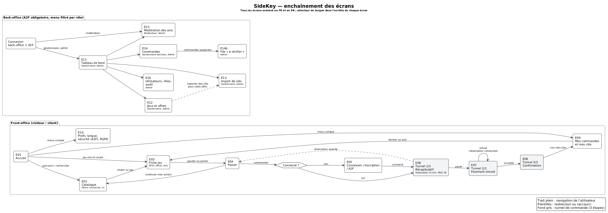

# Dossier de projet — SideKey

## Boutique en ligne de clés de licence de jeux vidéo

| Élément | Valeur |
|---|---|
| Titre visé | Concepteur Développeur d'Applications (CDA) — REAC TP-01281 v04 du 24/05/2023 |
| Activité type couverte | **AT2** — Concevoir et développer une application sécurisée organisée en couches · **AT3** (partie DevOps : CI/CD) |
| Projet | SideKey, projet de formation en binôme (MSP) |
| Auteurs | [Michel Simonin] · [Benjamin Nativel] |
| Version du dossier | **v1 — 24/11/2026** (première version, rédigée en cours de projet ; mises à jour le 24/11 : PR #40, vérification de la conception C-03 et décisions sur le modèle de données) |
| Dépôt | `MichelSimonin/SideKey` sur GitHub |

> **Comment lire cette version.** Le dossier est rédigé au fil du projet, comme le prévoit la définition de « terminé » du backlog. Chaque section porte un état :
> ✅ rédigé à partir de livrables existants · 🟡 partiellement rédigé · ⏳ à rédiger quand la fonctionnalité sera livrée.
> Le récapitulatif complet est au [§13](#13-état-davancement-de-la-v1).
>
> **Dossier individuel.** Chaque membre du binôme présente son propre dossier. Cette v1 est une **base commune** : chacun la reprend, met en avant les features qu'il a menées de bout en bout (§4.3) et rédige seul les §10 et §11.

---

## Sommaire

1. [Compétences du référentiel couvertes](#1-compétences-du-référentiel-couvertes)
2. [Résumé du projet / Project summary](#2-résumé-du-projet--project-summary)
3. [Contexte et expression des besoins](#3-contexte-et-expression-des-besoins)
4. [Gestion de projet](#4-gestion-de-projet)
5. [Spécifications fonctionnelles](#5-spécifications-fonctionnelles)
6. [Spécifications techniques](#6-spécifications-techniques)
7. [Sécurité](#7-sécurité)
8. [Réalisations : extraits de code commentés](#8-réalisations--extraits-de-code-commentés)
9. [Plan de tests et jeu d'essai](#9-plan-de-tests-et-jeu-dessai)
10. [Veille sur les vulnérabilités](#10-veille-sur-les-vulnérabilités)
11. [Situation de travail : recherche anglophone](#11-situation-de-travail--recherche-anglophone)
12. [Conclusion et perspectives](#12-conclusion-et-perspectives)
13. [État d'avancement de la v1](#13-état-davancement-de-la-v1)
14. [Annexes](#14-annexes)

---

## 1. Compétences du référentiel couvertes

| Compétence (AT2) | Ce qui la démontre dans SideKey | Section | État |
|---|---|---|---|
| **C5** — Analyser les besoins et maquetter une application | 7 personas, besoins BX-01 à BX-24, user stories MoSCoW, maquettes Figma FR (EN en cours), schéma d'enchaînement, exigences RGAA, RGPD et éco-conception | §3, §5 | 🟡 |
| **C6** — Définir l'architecture logicielle d'une application multicouche répartie | Architecture SPA ↔ API REST en couches ↔ PostgreSQL + Redis, matrice de justification de la stack, 8 ADR, diagrammes de composants et de déploiement, DICP, patrons de conception et de sécurité | §6, §7 | ✅ conception · ⏳ implémentation |
| **C7** — Concevoir et mettre en place une base de données relationnelle | MCD (20 entités), MLD (21 tables), MPD PostgreSQL 17 ; rôles SGBD, jeu d'essai, sauvegarde et restauration | §6.4, §8.5 | ✅ conception · ✅ schéma, rôles, jeu d'essai (T-01) · ✅ PL/pgSQL (T-02) |
| **C8** — Développer des composants d'accès aux données SQL et NoSQL | Repositories Doctrine, PL/pgSQL défensif, `FOR UPDATE SKIP LOCKED`, verrouillage optimiste, Redis (panier, réservations, jetons, limitation de débit) | §6.6, §6.7, §7.4, §8 | 🟡 PL/pgSQL et `SKIP LOCKED` (T-02), Redis (F-05, F-03, F-01), repositories DBAL dont le chiffrement des clés (F-08) et la commande transactionnelle prouvée en concurrence réelle (F-06) · ⏳ verrouillage optimiste (F-09) |
| **AT3 (partie DevOps)** — Préparer et automatiser le déploiement | Environnement Docker de développement, CI GitHub Actions bloquante, protection de `main`, CD vers une recette dans l'UE | §4.4, §8.1 | 🟡 CI faite · ⏳ CD (T-04) |

---

## 2. Résumé du projet / Project summary

### 2.1 Résumé (français)

SideKey est une boutique en ligne **fictive** de **clés de licence** de jeux vidéo (Steam, PlayStation, Xbox, Nintendo). Le client choisit un jeu, paie (paiement **simulé**) et récupère sa clé immédiatement dans son espace. Un back-office permet aux gestionnaires d'importer des clés en lot, de gérer le catalogue, de traiter les commandes suspectes et de modérer les avis.

La difficulté du projet tient à la nature du produit : **une clé est un bien unique et sensible**. Elle ne doit jamais être vendue deux fois, même si deux clients achètent la dernière en même temps, et elle ne doit jamais fuiter, y compris aux yeux des employés. Le projet répond à ces contraintes par une architecture en couches (React, API Symfony, PostgreSQL, Redis), un verrouillage des lignes en base, le chiffrement AES-256-GCM des clés, une authentification JWT avec A2F et un journal d'audit immuable. L'application est bilingue français / anglais, conçue pour l'accessibilité (RGAA) et l'éco-conception, et livrée par une chaîne CI/CD GitHub Actions.

### 2.2 Summary (English)

SideKey is a **fictional** online store selling video game **licence keys** (Steam, PlayStation, Xbox, Nintendo). Customers pick a game, pay through a **simulated** payment provider and get their key instantly in their account. A back office lets staff import keys in bulk, manage the catalogue, review suspicious orders and moderate reviews.

The main challenge comes from the product itself: **a key is a unique and sensitive asset**. It must never be sold twice, even when two customers buy the last one at the same time, and it must never leak, not even to employees. The project addresses this with a layered architecture (React, Symfony API, PostgreSQL, Redis), row-level locking in the database, AES-256-GCM encryption of keys, JWT authentication with two-factor authentication, and an append-only audit log. The application is bilingual (French / English), designed for accessibility and low environmental impact, and delivered through a GitHub Actions CI/CD pipeline.

---

## 3. Contexte et expression des besoins

### 3.1 Contexte et objectifs ✅

| # | Objectif | Indicateur de réussite |
|---|---|---|
| O1 | Acheter un jeu en moins de 5 écrans | Tunnel catalogue → fiche → panier → paiement → confirmation |
| O2 | Une clé n'est attribuée qu'à une seule commande | 0 doublon au test de concurrence |
| O3 | Protéger les clés et les données personnelles | Clés chiffrées, A2F back-office, tests OWASP passés |
| O4 | Outiller les gestionnaires | Catalogue, import de clés, commandes, modération |
| O5 | Application bilingue FR / EN | 100 % des libellés traduits |
| O6 | Livrer en continu de façon fiable | Pipeline CI/CD vert, déploiement automatisé en recette |

**Périmètre v1** : catalogue, recherche et filtres, fiche jeu, panier, compte client (A2F facultative), commande, paiement simulé, livraison des clés dans l'espace client, avis, back-office, FR / EN, CI/CD.
**Hors périmètre** : jeux d'occasion et stock physique (périmètre limité aux clés de licence), paiement réel, autres langues, application mobile native, autre base NoSQL que Redis.


### 3.2 Une démarche guidée par les personas ✅

Règle que nous nous sommes fixée, en cohérence avec le REAC : **chaque outil et chaque technologie doit être justifié par un besoin exprimé par un persona fictif**. Sept personas ont été définis ; chacun porte des besoins numérotés (`BX-nn`) qui sont repris dans les user stories, les écrans et la matrice de justification de la stack.

| Persona | Profil | Besoins clés |
|---|---|---|
| P1 Léa | 23 ans, étudiante, achète sur mobile | Recherche rapide (BX-01), clé immédiate (BX-02), confiance (BX-03), tunnel court (BX-04) |
| P2 Marcus | Anglophone installé en France | Application entièrement en anglais (BX-05, BX-06), A2F (BX-07) |
| P3 Sophie | Malvoyante, lecteur d'écran | Navigation clavier (BX-08), PEGI lisible (BX-09), erreurs claires (BX-10) |
| P4 Karim | Gestionnaire catalogue | Import en lot (BX-11), stock bas (BX-12), clés jamais en clair (BX-13), pas d'écrasement (BX-14) |
| P5 Nathalie | Gérante, administratrice | Anti-fraude (BX-15), traçabilité (BX-16), RGPD et UE (BX-17), A2F obligatoire (BX-18), restauration (BX-19) |
| P6 Thomas | Modérateur | Modérer sans accès aux commandes ni aux clés (BX-20) |
| P7 Hugo | Développeur qui reprendra le projet | Installation en une commande (BX-21), tests et qualité (BX-22), déploiements réversibles (BX-23), historique lisible (BX-24) |

### 3.3 User stories et règles de gestion ✅

Les besoins sont traduits en **user stories priorisées MoSCoW**, avec critères d'acceptation : catalogue (US-01 à US-05), panier (US-10 à US-13), compte (US-20 à US-25), commande et paiement (US-30 à US-36), avis (US-40 à US-42), back-office (US-50 à US-58). Elles sont accompagnées de règles de gestion numérotées, dont :

- **RG-04** — cycle de vie d'une clé : `DISPONIBLE` → `RESERVEE` → `VENDUE` ; une clé vendue ne peut plus être modifiée ;
- **RG-11** — le montant est toujours calculé côté serveur ;
- **RG-12** — les clés sont réservées 15 minutes pendant le paiement ;
- **RG-14** — anti-fraude de niveau « Équilibré » : 5 clés par offre et par commande, 10 clés par client sur 24 h, blocage d'1 h après 3 échecs de paiement, commande mise « à vérifier » si le compte a moins de 24 h et le montant dépasse 150 €, ou si la première commande dépasse 200 €.

Le niveau anti-fraude a été **choisi par comparaison** de trois niveaux (Souple, Équilibré, Strict) selon leur effet sur Léa (fluidité) et sur Nathalie (maîtrise du risque).

Source : CDC §5 et §6.

---

## 4. Gestion de projet

### 4.1 Méthode ✅

- **Durée** : 2 à 3 semaines, soutenance en semaine 3 ; planning de 13 jours.
- **Sprints journaliers**, adaptés à la durée courte du projet : planification de 15 min, point de mi-journée, démo du soir sur la recette, rétrospective express, compte rendu.
- **Le binôme porte le rôle de Product Owner** ; les personas servent de voix de l'utilisateur.
- **Gestion par feature** : chaque membre mène des features de bout en bout (front, API, base, tests), pour pouvoir défendre seul toutes les compétences.

### 4.2 Outils ✅

| Besoin | Outil | Justification |
|---|---|---|
| Backlog, Kanban, jalons | GitHub Projects | Lié aux issues, PR et CI au même endroit |
| Code et revues | GitHub, PR obligatoires | Relecture croisée systématique |
| CI/CD | GitHub Actions | Bloque la fusion si un contrôle échoue |
| Modélisation | PlantUML | Diagrammes en texte, versionnés et relus en PR |
| Maquettes | Figma | Composants, variantes FR / EN, desktop et mobile |
| Environnement | Docker Compose + Makefile | Installation identique sur chaque poste (BX-21) |

### 4.3 Backlog et répartition ✅

Le backlog compte **36 éléments**, importés dans GitHub Projects par un script (`scripts/import_backlog.py`) qui crée les issues, labels, jalons et champs (Priorité, Attribution, Estimation, Jour, ID) :

| Groupe | Contenu | Attribution |
|---|---|---|
| Conception et socle (S1) | C-01 à C-03, T-00 à T-04, F-02 à F-05 | Ensemble, M1, M2 |
| Features prioritaires (S2) | F-01, F-06 à F-10, T-03 | M1 / M2 |
| Pool (J10+) | P-01 à P-13, classées par rang | Attribuées au fil de l'avancement |
| Livraison (S3) | L-01 à L-05 | Ensemble |

Règles d'attribution du pool : le premier membre libre prend la feature la mieux classée ; une seule feature en cours par personne ; une feature en retard est réattribuée à la revue du soir ; aucune nouvelle feature après le J10.

> ⏳ **À compléter par chaque candidat** : la liste des features menées personnellement, avec le lien des PR.

### 4.4 Conventions Git et protection de `main` ✅

- **Une branche par tâche**, nommée `<type>/<ID>-<description>` (ex. `ci/T-00-ci-et-tests-unitaires`, `docs/C-02-maquettes-enchainement-ecrans`), créée depuis un `main` à jour.
- **Conventional Commits** ; le titre de la PR devient le message du commit (squash merge) et il est vérifié en CI (`pr-title`).
- **Protection de `main`** : PR obligatoire, approbation de l'autre membre, contrôles `ci-success` et `pr-title` exigés, historique linéaire, pas de push forcé, aucune exception même pour les administrateurs ; tags `v*` protégés.
- **Sécurité du dépôt** : A2F sur les comptes, Dependabot, secret scanning et push protection, aucun `.env` versionné (seuls les `.env.example`).

### 4.5 Historique réel ✅

| PR | Contenu | Issue |
|---|---|---|
| #37 | CI GitHub Actions et premiers tests unitaires | T-00 (#2) |
| #38 | Modélisation des données, architecture, 8 ADR, analyse DICP | C-03 (#4, fermée) |
| #39 | Inventaire des écrans, enchaînement, maquettes Figma desktop | C-02 (#3) |
| #40 | Préparation du mobile et de l'anglais : textes FR → EN de E01 à E08, spécification mobile, grille de revue persona | C-02 (#3) |
| #41 | Première version du dossier de projet ; décisions de cadrage reformulées en choix du binôme selon le REAC | L-03 (#34) |
| #42 | Décisions sur les 4 points ouverts du modèle de données | C-03 (#4) |
| #43 | Internationalisation FR / EN : react-i18next, sélecteur, `lang`, erreurs de l'API traduites selon `Accept-Language` | F-02 (#7, fermée) |
| #44 | Schéma PostgreSQL, contraintes, comptes SGBD, jeu d'essai, sauvegarde et restauration | T-01 (#5, fermée) |
| #45 | Fonctions et triggers PL/pgSQL défensifs, test de concurrence sur la dernière clé | T-02 (#8, fermée) |
| #46 | Panier Redis (TTL glissant), minuteur de réservation, libération planifiée, Doctrine | F-05 (#11, fermée) |
| #47 | Authentification JWT, jeton de rafraîchissement rotatif et RBAC | F-03 (#9, fermée) |
| #48 | Catalogue, recherche, filtres et cache Redis | F-01 (#12, fermée) |
| #49 | Clés de licence : import CSV, chiffrement AES-256-GCM, empreinte HMAC, révélation journalisée | F-08 (#13, fermée) |
| (en cours) | Commande transactionnelle : réservation des clés, annulation, historique, test de concurrence sur la dernière clé | F-06 (#15) |

> ⏳ Les comptes rendus quotidiens (`docs/cr/AAAA-MM-JJ.md`) prévus au CDC §16.1 ne sont pas encore tenus : à démarrer pour alimenter ce paragraphe.

---

## 5. Spécifications fonctionnelles

### 5.1 Acteurs et cas d'utilisation ✅

| Acteur | Persona | Rôle |
|---|---|---|
| Visiteur | P1, P2, P3 | Consulte le catalogue |
| Client | P1, P2, P3 | Commande, révèle ses clés, dépose des avis |
| Gestionnaire | P4 | Catalogue, offres, import de clés |
| Modérateur | P6 | Modération des avis |
| Administrateur | P5 | Comptes et rôles, audit, commandes suspectes |
| PSP simulé, serveur SMTP | — | Systèmes externes |

Diagrammes : [cas d'utilisation global](../uml/exports/uc-global.svg), [front-office](../uml/exports/uc-front-office.svg), [back-office](../uml/exports/uc-back-office.svg).

### 5.2 Maquettes et enchaînement des écrans 🟡

16 écrans (E01 à E16) sont spécifiés ; chacun est relié aux user stories, aux besoins et aux personas qui le justifient, avec ses points RGAA ([inventaire](../maquettes/ecrans.md)).

- **Schéma d'enchaînement** en PlantUML ([source](../maquettes/enchainement-ecrans.puml), [SVG](../maquettes/enchainement-ecrans.svg)) :



- **Maquettes Figma** « SideKey — Maquettes » : composants SideKey (en-tête et pied de page FR / EN, carte jeu, badge PEGI, étapes du tunnel, bandeau « paiement fictif », menu admin) construits sur les composants et tokens du Simple Design System ; **E01 à E16 en desktop FR** réalisés.
- 📝 Préparés : [spécification des écrans mobiles](../maquettes/mobile.md) (E02, E03, E04, E07), [textes FR → EN](../maquettes/traduction-en.md) du parcours E01 → E08, [grille de revue persona](../maquettes/revue-persona.md).
- ⏳ Restent : dessiner le **mobile** et le **parcours EN** dans Figma, puis faire la **revue persona** à deux.

- ✅ **Réalisé dans le front** : **E05** connexion / inscription (F-03), `front/src/features/auth/` ; routes `/connexion` et `/inscription`. Accessibilité : étiquettes visibles reliées aux champs, `autocomplete` adapté (`username`, `current-password`, `new-password`, `given-name`, `family-name`, `email`), erreurs reliées par `aria-describedby` et `aria-invalid`, résumé des erreurs annoncé (`role="alert"`) et focalisé, vue active signalée par `aria-current`, décompte de caractères annoncé poliment, aucune limite de temps, mot de passe affichable. FR et EN complets.
- ✅ **E05, seconde étape (F-04)** : saisie du code (TOTP ou code de secours, `autocomplete="one-time-code"`), **enrôlement** obligatoire pour le back-office (QR code avec texte alternatif, clé de saisie manuelle pour qui ne peut pas scanner, instructions numérotées), **dix codes de secours montrés une seule fois** ; le titre de chaque étape reçoit le focus, les erreurs sont reliées au champ, aucune limite de temps côté utilisateur. Le jeton intermédiaire, le secret et les codes ne vivent qu'en mémoire du composant.

- ✅ **Réalisés dans le front** : **E02** catalogue (`/catalogue`) et **E03** fiche jeu (`/jeux/:slug`), F-01, `front/src/features/catalogue/`. E02 : grille paginée par 20, filtres plateforme / genre / prix / PEGI / recherche / tri regroupés en `fieldset` + `legend`, **critères reflétés dans l'URL** (lien partageable, bouton « précédent »), nombre de résultats annoncé dans une région `aria-live`, message explicite si aucun résultat, pagination en vrais liens. E03 : jaquette, description FR / EN, éditeur, **PEGI écrit en texte**, offres par plateforme avec prix et **stock en toutes lettres** (« 12 clés disponibles »), note moyenne, ajout au panier (API F-05). FR et EN complets.

> ⏳ Insérer ici les captures des écrans clés (E02 catalogue, E03 fiche jeu, E07 paiement, E14 commandes à vérifier) exportées de Figma.

### 5.3 Exigences transverses ✅

| Domaine | Exigences principales |
|---|---|
| **Accessibilité (RGAA 4)** | Contrastes AA, navigation clavier, focus visible, labels et erreurs reliés aux champs, `lang` mis à jour, PEGI et stock écrits en texte |
| **RGPD** | Minimisation (pas d'adresse, pas de date de naissance), durées de conservation (anonymisation après 3 ans d'inactivité, 10 ans pour les pièces comptables, 6 mois à 1 an pour les journaux), export et suppression du compte, hébergement UE |
| **Éco-conception (RGESN)** | Images WebP en différé, pagination, cache Redis, une seule police ; cible page < 1 Mo et EcoIndex B |
| **Multilingue** | FR / EN uniquement ; interface, erreurs de l'API, e-mails et contenus du catalogue traduits ; test CI si une clé manque |

**Éco-conception mise en œuvre (F-01, RGESN)** : choix faits pour que le catalogue pèse peu, côté réseau comme côté serveur.

| Levier | Mise en œuvre | Effet |
|---|---|---|
| Images | `loading="lazy"`, `decoding="async"`, `width` et `height` déclarés sur chaque jaquette ; format WebP ; aucune image décorative ; une jaquette absente ou en erreur est remplacée par un bloc de texte | Une image hors écran n'est pas téléchargée ; pas de décalage de mise en page ; zéro octet pour un jeu sans jaquette |
| Pagination | 20 jeux par page, jamais le catalogue entier ; une page au-delà du dernier résultat n'exécute pas la requête de lecture | Charge réseau et SQL bornées, quelle que soit la taille du catalogue |
| Cache | Redis côté serveur (5 min) ; `Cache-Control: public, max-age=60` (liste, fiche) et 300 s (filtres) avec `Vary: Accept-Language` côté HTTP | Une lecture répétée ne touche ni PostgreSQL ni le serveur d'application quand un cache intermédiaire s'en charge |
| Charge de calcul | Pas de bibliothèque de recherche ni de requête plein texte : un `LIKE` sur quelques dizaines à quelques milliers de titres ; recherche déclenchée à la validation du formulaire, pas à chaque frappe | Aucune requête par touche pressée |
| Données transférées | DTO de sortie minimaux (une carte = 9 champs), prix et libellés déjà calculés par le serveur, aucun champ inutilisé | Réponses de liste de l'ordre de quelques ko |
| Front | Une seule dépendance ajoutée par F-03 pour le routage (`react-router-dom`) ; F-01 n'en ajoute aucune ; police système, pas de bibliothèque de composants (bundle : 112 ko compressés) | Page légère, rendu rapide sur mobile |

---

## 6. Spécifications techniques

### 6.1 Stack et justification ✅

| Couche | Choix | Besoins couverts | Alternative écartée |
|---|---|---|---|
| API | **Symfony 7.4 LTS**, PHP 8.4 | BX-03, BX-15, BX-16, BX-18, BX-22 | Laravel : couches moins explicites |
| ORM | Doctrine ORM + Migrations | BX-03, BX-14, BX-21 | SQL écrit à la main partout |
| Front | **React 19** + Vite + TypeScript | BX-01, BX-04, BX-08 | Rendu serveur Twig |
| SGBDR | **PostgreSQL 17** | BX-03, BX-19 | MySQL : rôles et PL moins riches |
| NoSQL | **Redis 8** (clé/valeur) | BX-01, BX-04, BX-15 | MongoDB : pas de besoin identifié |
| Authentification | JWT + jeton de rafraîchissement + A2F TOTP | BX-03, BX-07, BX-18 | Session serveur, A2F par SMS |
| Conteneurs | Docker Compose | BX-21, BX-23 | Installation locale |
| CI/CD | GitHub Actions | BX-22, BX-23 | GitLab CI |

Chaque décision structurante est tracée dans un **ADR** (contexte, options étudiées, décision, conséquences) : [index des 8 ADR](../adr/README.md).

### 6.2 Architecture en couches ✅

```text
Navigateur (SPA React)
   │  HTTPS, JSON, jeton d'accès en mémoire
   ▼
API REST Symfony
   ├── Présentation : contrôleurs, DTO validés, codes HTTP
   ├── Métier       : services, Voters (RBAC, propriété), transactions, anti-fraude, audit
   └── Données      : repositories Doctrine, appels PL/pgSQL, client Redis, chiffrement
   ▼                         ▼
PostgreSQL (référence)     Redis (paniers, réservations, jetons, compteurs, cache)
```

Chaque couche ne dépend que de la couche inférieure ; les règles de dépendance sont vérifiées en revue. Détail, cycle de vie d'une requête et contrat d'erreurs : [architecture en couches](../architecture/architecture-couches.md) · diagrammes [composants](../uml/exports/archi-couches.svg) et [déploiement](../uml/exports/deploiement.svg).

**Patrons de conception** : Repository, DTO, Service Layer, Strategy (fournisseur de paiement), Factory, Observer (événements Symfony), Command (Messenger).

### 6.3 Modélisation UML ✅

17 diagrammes PlantUML versionnés (`docs/uml/src/`), exportés en PNG et SVG par `make uml` : cas d'utilisation, classes du domaine, états (commande, clé de licence), séquences (achat concurrent, paiement, connexion JWT, révélation de clé, import de clés). Index : [docs/uml](../uml/README.md).

### 6.4 Base de données relationnelle ✅

- **MCD** de 20 entités et 26 associations, **MLD** de 21 tables, **MPD** PostgreSQL 17 avec types, contraintes, index partiels et triggers : [modèle de données commenté](../architecture/modele-donnees.md), [MCD](../uml/exports/mcd.svg), [MLD](../uml/exports/mld.svg), [MPD](../uml/exports/mpd.svg).
- **Contraintes clés** : empreinte HMAC unique par clé, une seule offre active par couple jeu × plateforme (index unique partiel), `CHECK (quantite BETWEEN 1 AND 10)`, colonne `version` pour le verrouillage optimiste.
- **Comptes SGBD à moindre privilège** : `sk_owner` (migrations), `sk_app` (API, sans `DELETE` sur les clés, commandes, paiements et audit), `sk_reporting` (lecture de vues sans données personnelles), `sk_backup`.
- **Objets PL/pgSQL défensifs** (T-02) : `fn_reserver_cles`, `fn_valider_commande` (idempotente), `fn_liberer_reservations_expirees` ; triggers de transitions de statut (§6.4 du CDC), d'historique, de protection des clés vendues et d'immuabilité du journal d'audit et de l'historique. Paramètres vérifiés, `SECURITY INVOKER`, `search_path` figé, `EXECUTE` pour `sk_app` seulement, codes d'erreur `SK001` à `SK005` traduits en HTTP 409 par l'API ([modèle de données §4.4](../architecture/modele-donnees.md), extrait §8.5).
- **Jeu d'essai** (T-01) : 40 jeux FR / EN, 60 offres, 500 clés dans tous les états, 20 utilisateurs de tous rôles, commandes dans chaque statut ; sauvegarde `pg_dump -Fc` et restauration `pg_restore --clean`.

- **Preuves automatisées** (job CI « database ») : migrations sur base vide, tests SQL des contraintes, des droits, des fonctions et des triggers (cas d'erreur et cas nominaux), sauvegarde puis restauration comparée table par table, scénario de concurrence à deux sessions, annulation complète des migrations.

### 6.5 Validation de la conception (C-03) ✅

La conception (issue C-03, #4) a été livrée par la PR #38, relue et approuvée, CI verte. Ses critères d'acceptation ont été revérifiés dans le dépôt le 24/11/2026 :

| Critère | Vérification |
|---|---|
| Sources PlantUML versionnées avec leurs exports | ✅ 17 sources, chacune avec son export PNG et SVG |
| MCD, MLD et MPD cohérents | ✅ jeu, éditeur, plateforme, utilisateur, commande, ligne de commande et clé de licence présents aux trois niveaux |
| Séquence de l'achat concurrent | ✅ `seq-achat-concurrent`, avec `FOR UPDATE SKIP LOCKED` |
| ADR des choix structurants | ✅ 8 ADR au statut « Accepté » (Symfony + React, PostgreSQL + Redis, JWT, chiffrement, hébergement UE, couches, PlantUML, paiement simulé) |
| DICP et patrons de sécurité | ✅ [dicp.md](../securite/dicp.md), [security-patterns.md](../securite/security-patterns.md) |

**Décisions prises par le binôme le 24/11/2026** sur les points restés ouverts (détail : [modèle de données §7](../architecture/modele-donnees.md)) :

| # | Point | Décision |
|---|---|---|
| 1 | Langue d'un avis | Détectée automatiquement à partir du commentaire, côté serveur et sans service externe ; à défaut, langue de l'utilisateur (P-01) |
| 2 | Langue de la commande | Conservée : langue au moment de l'achat, utilisée pour l'e-mail et la preuve (F-06) |
| 3 | Purge du journal d'audit | Conservation 12 mois (RGPD, recommandation CNIL) ; purge automatisée en v2 |
| 4 | Codes de secours A2F | 10 codes régénérés en bloc à chaque activation de l'A2F, anciens supprimés (F-04) |

Aucune de ces décisions ne change la structure des tables : T-01 peut démarrer.

Les points de la définition de terminé liés au code (tests, FR / EN, validation par couche, déploiement en recette) ne s'appliquent pas à un ticket de conception.

### 6.6 NoSQL : Redis ✅ conception · 🟡 implémentation (panier et réservation : F-05 ; jetons, révocation, débit : F-03)

| Usage | Clé | TTL |
|---|---|---|
| Panier | `cart:{userId}` / `cart:anon:{uuid}` | 7 j / 24 h |
| Réservation des clés | `resa:{commandeId}` | 15 min |
| Jetons de rafraîchissement | `refresh:{jti}` → `userId:familleId` ; `refresh:used:{jti}` → `familleId` ; `refresh:family:{familleId}` (ensemble) | 7 j |
| Révocation des jetons d'accès | `jwt:deny:{jti}` ; `jwt:deny:fam:{familleId}` | durée restante / 15 min |
| Limitation de débit, anti-fraude | `rl:login:{ip}`, `rl:register:{ip}`, `rl:a2f:{userId}`, `fraud:keys24h:{userId}` | 15 min / 1 h / 15 min / 24 h |
| Code TOTP déjà utilisé | `a2f:used:{userId}:{pas}` | 120 s |
| Cache catalogue | `cache:jeu:{slug}:{langue}`, `cache:jeux:v{n}:{langue}:{empreinte}`, `cache:filtres:v{n}:{langue}`, `cache:jeux:version` | 5 min (le compteur de version n'expire pas) |

Principe : **aucune donnée de référence dans Redis** ; sa perte coûte des paniers et des sessions, jamais une commande ni une clé.

**Réalisé (F-05)** :
- **Panier** (`RedisPanierStore`) : un hash par panier (offre → quantité). Écriture et expiration partent dans une même transaction `MULTI` / `EXEC`, et chaque écriture repousse l'expiration : un panier abandonné disparaît seul, sans tâche de purge. Le panier ne contient que des identifiants et des quantités ; prix, titres et stock sont relus dans PostgreSQL à chaque affichage, et le total est calculé côté serveur (RG-11).
- **Règles** (`PanierService`) : 5 clés au plus par offre (RG-14), jamais plus que le stock disponible, 20 offres au plus ; une offre retirée de la vente ou en rupture disparaît du panier et le client en est informé.
- **Visiteur** : panier identifié par un cookie opaque (uuid aléatoire), `HttpOnly`, `Secure`, `SameSite=Strict` ; une valeur forgée est ignorée et ne peut pas désigner une autre clé Redis.
- **Réservation** : minuteur `resa:{commandeId}` aligné sur l'échéance de la commande ; l'expiration réelle reste en base, appliquée chaque minute par une tâche planifiée (Symfony Scheduler, service `worker`) qui appelle `fn_liberer_reservations_expirees`.
- **Tests** : composant Redis contre un vrai serveur (TTL, expiration réelle, transaction), accès SQL sur la base de test, API de bout en bout ; PostgreSQL et Redis tournent dans la CI.

**Réalisé (F-04)** :
- **Code TOTP à usage unique** (`RedisUsageUniqueTotp`) : `a2f:used:{userId}:{pas}` posé avec `SET NX EX 120` : le contrôle et l'écriture sont un seul ordre atomique, donc deux requêtes simultanées avec le même code ne passent pas toutes deux. 120 s couvrent la fenêtre de ±1 pas (90 s).
- **Limitation** `rl:a2f:{userId}` : même compteur à fenêtre fixe que `rl:login:{ip}` (5 tentatives par 15 min), par compte puisque le jeton intermédiaire identifie l'utilisateur.

**Réalisé (F-01)** :
- **Cache du catalogue** (`RedisCatalogueCache`, interface `CatalogueCache`) : lecture directe (*cache-aside*), valeurs en **JSON** (jamais de `serialize()` PHP) avec TTL de 5 minutes. Une fiche = une clé par langue (`cache:jeu:{slug}:{langue}`). Une liste filtrée = `cache:jeux:v{n}:{langue}:{empreinte}` où `{empreinte}` est le SHA-256 des critères normalisés (ordre des cases, casse et espaces ignorés) : seules des valeurs validées (slug conforme, langue de l'énumération, empreinte) entrent dans une clé.
- **Invalidation** : `invaliderJeu(slug)` supprime la fiche dans les deux langues ; `invaliderListes()` **incrémente** `cache:jeux:version` : toutes les listes et valeurs de filtres deviennent caduques en une opération O(1), les anciennes entrées expirant seules par TTL (aucun `SCAN` ni `DEL` en masse). Toute écriture du catalogue doit appeler les deux (le back-office F-09 s'y branchera) ; le TTL de 5 minutes n'est qu'un filet de sécurité. Documenté dans `architecture-couches.md` §7.
- **Disponibilité d'abord** : si Redis ne répond pas, les lectures renvoient « absent », les écritures sont ignorées et l'incident est journalisé ; le catalogue se lit alors directement en base. À l'inverse de l'authentification (qui refuse), le cache n'est qu'une optimisation de données publiques.
- **Un 404 n'est jamais mis en cache**, et un slug mal formé ne touche ni la base ni Redis : un client ne peut pas inonder Redis de clés.
- **Tests** : composant Redis contre un vrai serveur (clés, TTL réel, invalidation, entrée corrompue ou à objet sérialisé, Redis arrêté), API de bout en bout (la fiche reste celle du cache malgré une modification en base, puis se rafraîchit après invalidation).

**Réalisé (F-03)** :
- **Jetons de rafraîchissement** (`RedisStockRefresh`) : le jeton opaque n'est **jamais** une clé Redis, seule son empreinte SHA-256 l'est (`{jti}` ci-dessus) : un export de Redis ne livre aucune session utilisable. La rotation est un **script Lua** exécuté d'un bloc par Redis : le jeton actif est supprimé, un marqueur `refresh:used:{jti}` le remplace, son successeur hérite du compte et de la famille. Deux requêtes simultanées avec le même jeton ne peuvent donc pas réussir toutes les deux.
- **Réutilisation d'un jeton consommé** : le marqueur `used` le trahit ; le script supprime alors tous les jetons actifs de la famille (`refresh:family:{id}`) et le service pose `jwt:deny:fam:{id}`, de sorte que les jetons d'accès déjà émis pour cette session sont refusés eux aussi (15 min au plus).
- **Révocation des jetons d'accès** (`RedisRevocationJwt`) : `jwt:deny:{jti}` pour la durée restante du jeton (déconnexion), sans trace une fois le jeton expiré. Si Redis ne répond pas, le jeton est refusé (Fail Securely, ADR-0003).
- **Limitation de débit** (`RedisLimiteurDebit`) : compteur à fenêtre fixe, `INCR` et `EXPIRE` dans un script Lua (jamais de compteur sans expiration), 10 connexions par fenêtre de 15 min et par adresse (`rl:login:{ip}`), 5 créations de compte par heure (`rl:register:{ip}`). Au-delà : 429 avec `Retry-After`. Une adresse qui n'est pas une IP valide ne devient jamais une clé.
- **Tests** : trois classes d'intégration contre un vrai Redis (TTL de 7 j, expiration réelle, rotation, réutilisation, famille, entrées forgées refusées avant toute clé).

### 6.7 Concurrence et transactions ✅ conception · ✅ implémentation (F-06)

**Cas de référence : deux clients achètent la dernière clé en même temps.**

```sql
SELECT id FROM cle_licence
 WHERE offre_id = $1 AND statut = 'DISPONIBLE'
 ORDER BY id LIMIT $2
 FOR UPDATE SKIP LOCKED;
-- moins de lignes que demandé → exception → ROLLBACK « stock insuffisant »
```

`SKIP LOCKED` fait ignorer à la seconde transaction les lignes déjà verrouillées par la première : un seul client obtient la clé, sans doublon ni interblocage. Diagramme : [séquence de l'achat concurrent](../uml/exports/seq-achat-concurrent.svg). Pour deux gestionnaires qui modifient la même offre, un **verrouillage optimiste** (colonne `version`) refuse la seconde sauvegarde avec un HTTP 409. Le PSP simulé est appelé **hors transaction** pour ne pas garder de verrous pendant un appel externe.

**Mise en œuvre (F-06).** `POST /api/commandes` transforme le panier en commande dans **une seule transaction** (`CommandeRepository::creer`) :

| Étape | Instruction | Pourquoi |
|---|---|---|
| 1 | `SET TRANSACTION ISOLATION LEVEL READ COMMITTED` | Niveau choisi et écrit explicitement (CDC §10.3) |
| 2 | `SELECT … FROM utilisateur … FOR UPDATE` | Deux requêtes du même client (double clic, deux onglets) passent l'une après l'autre : la seconde voit la commande en attente et reçoit un 409 |
| 3 | `SELECT … FROM offre … FOR SHARE` | Le prix lu est celui qui est enregistré dans la ligne (RG-05) ; le montant est calculé ici, en centimes (RG-11) |
| 4 | `INSERT` commande et lignes, puis `fn_reserver_cles` par ligne, offres triées | `FOR UPDATE SKIP LOCKED` sur les clés ; offres verrouillées toujours dans le même ordre, donc sans interblocage |
| 5 | `COMMIT`, ou `ROLLBACK` de tout au premier `SK001` | Tout ou rien : aucune ligne sans clé, aucune clé réservée pour une commande annulée |

**Pourquoi READ COMMITTED et pas SERIALIZABLE.** Chaque décision repose sur une ligne verrouillée, que PostgreSQL relit à jour après l'attente : la sérialisation n'apporterait rien ici, sinon des échecs de sérialisation à rejouer côté application pour des transactions qui ne se gênent pas. Les effets dans Redis (minuteur de 15 min, panier vidé, cache du catalogue invalidé) n'ont lieu qu'après le `COMMIT` ; s'ils échouent, la commande reste valable.

**Preuve.** `AchatDerniereCleTest` lance **8 processus PHP indépendants** (noyau Symfony et connexion PostgreSQL chacun) qui commandent la dernière clé au même instant, derrière une barrière (verrou consultatif PostgreSQL) : 1 commande, 1 clé réservée, 0 doublon, 0 ligne sans clé. Sur quatre exécutions, 6 ou 7 perdants ont été refusés à la réservation (`SK001`) et 0 ou 1 en relisant son panier après la vente : la course a bien lieu dans la transaction. Un second test, déterministe, tient la clé sous verrou sur une connexion et montre que la seconde ne l'attend pas (`SKIP LOCKED`) et n'écrit rien.

### 6.8 Environnement de développement ✅

`make init` lance toute la stack : PHP 8.4-FPM, Nginx, PostgreSQL 17 (bases `sidekey` et `sidekey_test`), Redis 8 avec mot de passe, Node 24 pour Vite. Les ports ne sont ouverts que sur `127.0.0.1`. Le front appelle `/api` sur sa propre origine et Vite relaie vers Nginx : pas de CORS en développement.

---

## 7. Sécurité

### 7.1 Analyse DICP ✅

| Critère | Niveau | Biens principaux | Mesures |
|---|---|---|---|
| Disponibilité | 2/4 | Catalogue, tunnel | Cache, sauvegardes, contrôles de santé, retour arrière |
| Intégrité | 3/4 | Commandes, clés, prix | Contraintes, triggers, transactions, montants calculés côté serveur |
| Confidentialité | **4/4** | **Clés**, identifiants, données personnelles | AES-256-GCM, argon2id, A2F, Voters, TLS |
| Preuve | 3/4 | Révélations, actions admin, paiements | Journal d'audit immuable, historique des commandes |

Analyse complète (biens, scénarios de menace, risque résiduel accepté) : [dicp.md](../securite/dicp.md).

### 7.2 Mesures par menace (OWASP Top 10) ✅

| Menace | Parade retenue |
|---|---|
| A01 Contrôle d'accès, IDOR | Voters Symfony (rôle et propriété), références UUID, back-office réservé aux rôles avec A2F |
| A02 Cryptographie | TLS, AES-256-GCM, argon2id, secrets hors dépôt |
| A03 Injection, XSS | Doctrine et requêtes paramétrées, échappement JSX, CSP, HTML refusé dans les avis |
| A04 Conception | Anti-fraude, réservation avec TTL, idempotence du paiement |
| A05 Configuration | En-têtes de sécurité, aucune trace technique renvoyée, conteneurs sans root |
| A06 Composants vulnérables | Dependabot, `composer audit` et `npm audit` **bloquants en CI** |
| A07 Authentification | JWT de 15 min, rotation du jeton de rafraîchissement, limitation de débit, A2F TOTP |
| A09 Journalisation | Audit sans mot de passe, clé ni carte |

Patrons de sécurité retenus (Authenticator, Authorization Enforcer, Input Validator, Encrypted Storage, Limited View, Fail Securely…) : [security-patterns.md](../securite/security-patterns.md).

### 7.3 Authentification ✅ conception · ✅ implémentation (F-03, F-04)

- **Jeton d'accès** JWT **RS256** de 15 min, gardé **en mémoire** dans la SPA (jamais dans `localStorage`, lisible en cas de XSS). Revendications : `sub` (UUID du compte), `jti`, `fam` (session), `typ` (portée), `iat`, `exp`, `roles` ; ni e-mail ni nom dans le jeton. La clé privée vit hors dépôt (`api/config/jwt/*.pem`, générée par `make jwt-keys`).
- **Jeton de rafraîchissement** opaque (256 bits tirés de `random_bytes`) de 7 jours, à usage unique avec rotation, dans un cookie `HttpOnly; Secure; SameSite=Strict; Path=/api/token/refresh`, stocké (empreinte SHA-256) et révocable dans Redis ; la réutilisation d'un jeton déjà utilisé révoque toute la famille, jetons d'accès compris.
- **CSRF** : les appels à l'API passent par l'en-tête `Authorization`, que le navigateur n'envoie pas tout seul ; seule la route de rafraîchissement, à cookie, reçoit une protection dédiée à trois barrières : `SameSite=Strict`, en-tête `Origin` obligatoire et conforme à `CORS_ALLOW_ORIGIN`, et **double soumission signée** (l'en-tête `X-CSRF-Token` doit égaler le cookie `sk_csrf`, et cette valeur doit être le HMAC-SHA256 du jeton de rafraîchissement présenté : un cookie injecté par un tiers ne passe pas). Une requête refusée **ne consomme pas** le jeton : un attaquant ne peut pas déconnecter la victime.
- **Mots de passe** : 12 à 128 caractères, tous caractères acceptés, liste locale de mots de passe triviaux, refus de l'identité du titulaire, hachage **argon2id**, pas d'expiration forcée (recommandations ANSSI et CNIL). Constat d'implémentation : l'algorithme `auto` de Symfony 7.4 produit du **bcrypt** (`$2y$13$…`), contrairement à ce que supposait le CDC ; il est donc nommé explicitement dans `security.yaml`, et un test d'intégration vérifie le préfixe `$argon2id$`. Les comptes du jeu d'essai (bcrypt) migrent vers argon2id à leur première connexion.
- **Limitation de débit** : 10 tentatives de connexion par 15 min et par adresse (`rl:login:{ip}`), 429 avec `Retry-After`.
- **Anti-énumération** : e-mail inconnu, compte désactivé et mauvais mot de passe renvoient le même 401 ; un hachage factice est toujours vérifié pour égaliser le temps de réponse.
- **Autorisation (RBAC)** : matrice du CDC §11.5 portée par l'énumération `Permission` et décidée par `RbacVoter` ; les rôles sont **relus en base à chaque requête** (un rôle retiré ou un compte désactivé perd l'accès immédiatement, sans attendre les 15 min). Refus par défaut (`access_control`) ; accès refusé = 403 générique.
- **A2F TOTP** (F-04) obligatoire pour GESTIONNAIRE, MODERATEUR et ADMIN, facultative pour les clients. Connexion **en deux étapes** : le mot de passe ne donne qu'un **jeton intermédiaire** (JWT de portée `a2f`, 5 min, `a2f: false`), sans refresh ni jeton d'accès. Il n'ouvre **que** `/api/connexion/a2f…` : le pare-feu refuse le jeton d'accès sur ces routes et le jeton intermédiaire partout ailleurs (`JwtSubscriber`, portée déduite de la route). Il est **révoqué après usage** (`jwt:deny:{jti}`) : pas de seconde session. Un rôle du back-office **sans A2F configurée** n'obtient qu'un jeton d'**enrôlement** : QR code (SVG en URI de données, affiché dans un ``) et clé en texte, premier code pour confirmer, puis **10 codes de secours** montrés **une seule fois** ; la session n'est ouverte qu'à la fin.
- **Back-office fermé sans second facteur** : le jeton d'accès porte la revendication `a2f`, vraie seulement après vérification du code (ou renouvellement d'une session qui l'a passée). `RbacVoter` exige cette revendication pour **toute** permission du back-office (`Permission::estBackOffice()`, vrai par défaut pour toute nouvelle permission) : le rôle ne suffit plus. Les routes F-08 (`/api/admin/**`) en bénéficient sans modification.
- **Secret et codes** : secret TOTP de 160 bits chiffré en **AES-256-GCM lié au compte** (clé `TOTP_ENC_KEY`, distincte de celles des clés de licence) ; codes de secours de 50 bits (alphabet base32, `random_int`) **hachés en argon2id**, à usage unique (UPDATE conditionnel atomique), régénérés en bloc à l'activation. Un secret illisible (donnée factice du jeu d'essai, altération) compte comme un code faux, jamais comme un succès.
- **Tentatives limitées** : 5 par compte et par 15 min (`rl:a2f:{userId}`, 429 + `Retry-After`), codes de secours compris : un code à 6 chiffres ne se force pas. Un code TOTP **ne sert qu'une fois** (`a2f:used:{userId}:{pas}`, `SET NX`, 120 s) : un code intercepté puis rejoué dans sa fenêtre de ±1 pas est refusé. Journal d'audit : `A2F_ACTIVATION`, `A2F_ECHEC`, `A2F_CODE_SECOURS_UTILISE`, jamais une valeur secrète.
- **Constats d'implémentation** : (1) la taille de secret par défaut d'`otphp` est de 1024 bits (103 caractères), trop longue pour une saisie à la main : fixée à 160 bits (RFC 4226 §4) ; (2) une clé Redis de limitation `rl:a2f:…` était rejetée par la validation de F-03 (chiffre dans le préfixe) : corrigée avant tout usage.
- **Décisions de mise en œuvre** (une ligne chacune) : inscription avec e-mail déjà pris → 409, avec limitation par adresse (`rl:register:{ip}`) ; consentement exigé par le DTO mais non stocké (le schéma T-01 n'a pas de colonne dédiée) ; e-mail non vérifié à la création (l'envoi relève du ticket des e-mails) ; seul `a2f_active` déclenche la seconde étape dans F-03.
- Diagramme : [séquence de connexion JWT](../uml/exports/seq-connexion-jwt.svg) · décision : [ADR-0003](../adr/0003-jwt-et-jeton-de-rafraichissement.md) (§ « Mise en œuvre »).

### 7.4 Protection des clés de licence ✅ conception · ✅ implémentation (F-08)

Chiffrement **AES-256-GCM** avec IV aléatoire, clé maître dans un secret d'environnement ; unicité vérifiée par une **empreinte HMAC-SHA256** (le chiffré ne le permet pas, puisqu'il change à chaque chiffrement) ; déchiffrement uniquement pour le propriétaire d'une commande payée, et journalisé. Décision : [ADR-0004](../adr/0004-chiffrement-des-cles-de-licence.md) · séquence : [révélation d'une clé](../uml/exports/seq-revelation-cle.svg).

**Mise en œuvre (F-08).**

| Mesure | Où |
|---|---|
| Chiffré « version, IV, étiquette GCM, chiffré », lié à son offre (données associées) : altéré, tronqué ou recopié sur une autre offre, il est refusé | `Infrastructure/Crypto/ChiffreurClesAesGcm` |
| Deux secrets distincts de 32 octets (`LICENSE_KEY_ENC_KEY`, `LICENSE_KEY_HMAC_KEY`), vérifiés au démarrage du service | `config/services.yaml`, environnements GitHub |
| Empreinte HMAC de la forme canonique (majuscules, sans tirets) : « abcde-12345 » et « ABCDE12345 » sont un doublon | `Service/Cles/CleNormalisee` |
| Import CSV de 1 000 clés au plus, par lots de 500, doublons du fichier et du stock rejetés ligne à ligne, rapport sans aucune valeur de clé | `Service/Cles/ImportClesService`, `POST /api/admin/offres/{offreId}/cles` |
| Seuls les 4 derniers caractères sont gardés en clair (colonne `suffixe`), pour l'affichage masqué du back-office : choix du binôme | `api/sql/schema/004_cle_suffixe.sql` |
| Révélation : la requête SQL ne lit que les clés de l'utilisateur, puis le Voter exige CLIENT, commande `PAYEE` et clé `VENDUE`. Une clé d'autrui répond comme une clé inexistante (404) | `Service/Cles/LicenceService`, `Security/Voter/CleLicenceVoter` |
| Chaque affichage journalisé (`REVELATION_CLE`), adresse IP hachée ; réponse `Cache-Control: no-store` | `Repository/JournalAuditRepository`, `POST /api/cles/{id}/revelation` |
| Aucune clé dans les traces : paramètres `#[\SensitiveParameter]`, objets sans valeur dans `var_dump` | `Service/Cles/*` |

Un test de sécurité de bout en bout importe des clés, en révèle une, provoque une erreur de déchiffrement, puis cherche chaque clé (telle quelle, sans tirets, en minuscules, en hexadécimal) dans la base, les journaux de l'application et les réponses de l'API : elle ne doit apparaître que dans la réponse de révélation, pour son acheteur.

### 7.5 Paiement simulé ✅

Choix du binôme, justifié : la compétence évaluée porte sur la conception et l'accès aux données, pas sur l'intégration bancaire ; manipuler de vraies cartes imposerait la norme PCI DSS. Le patron **Strategy** permettra de brancher un vrai prestataire en v2 sans toucher au métier. Décision : [ADR-0008](../adr/0008-paiement-simule-et-anti-fraude.md).

---

## 8. Réalisations : extraits de code commentés

> 🟡 Les extraits ci-dessous viennent du code **déjà livré** (socle et CI). Les réalisations métier (concurrence, chiffrement, Voters, Redis) seront ajoutées au fil des features.

### 8.1 Une CI bloquante extensible sans toucher à la protection de `main`

`.github/workflows/ci.yml` (extrait) — un seul contrôle, `ci-success`, est exigé par la règle de protection ; il agrège les autres jobs. Ajouter un job ne demande donc pas de modifier la règle.

```yaml
  ci-success:
    name: ci-success
    if: always()
    needs: [api, front, docker]
    runs-on: ubuntu-latest
    steps:
      - name: Tous les jobs doivent réussir
        env:
          RESULTS: ${{ join(needs.*.result, ' ') }}
        run: |
          for r in $RESULTS; do
            if [ "$r" != "success" ]; then
              echo "::error::Un job de la CI n'a pas réussi ($r)"
              exit 1
            fi
          done
```

`if: always()` est indispensable : sans lui, un job en échec ferait **sauter** `ci-success`, et un contrôle sauté ne bloque pas la fusion.

### 8.2 Vérifier le titre de PR sans risque d'injection

`.github/workflows/pr-title.yml` (extrait) — le titre, saisi par l'utilisateur, est passé par **variable d'environnement** et jamais interpolé dans le script : un titre contenant `$(…)` ne peut pas exécuter de commande sur le runner.

```yaml
        env:
          TITLE: ${{ github.event.pull_request.title }}
        run: |
          pattern='^(feat|fix|docs|style|refactor|perf|test|build|ci|chore|revert)(\([a-z0-9._-]+\))?!?: .{3,100}$'
          if printf '%s' "$TITLE" | grep -Eq "$pattern"; then
            echo "Format valide."
          else
            echo "::error::Titre invalide. Attendu : type(portée optionnelle): description"
            exit 1
          fi
```

### 8.3 Une sonde de santé qui ne divulgue rien

`api/src/Controller/Api/HealthController.php` — utilisée par la CI, le déploiement et la supervision ; elle ne renvoie ni version ni environnement, et n'est jamais mise en cache.

```php
#[Route('/api/health', name: 'api_health', methods: ['GET'])]
public function __invoke(): JsonResponse
{
    $response = new JsonResponse(['status' => 'ok'], Response::HTTP_OK);
    $response->headers->set('Cache-Control', 'no-store');

    return $response;
}
```

### 8.4 Client HTTP du front

`front/src/api/client.ts` (extrait) — même origine (`credentials: 'same-origin'`), erreurs HTTP transformées en exceptions explicites, `fetch` injectable pour les tests.

```ts
export async function fetchHealth(fetchFn: typeof fetch = fetch): Promise<HealthStatus> {
  const response = await fetchFn(apiUrl('health'), {
    headers: { Accept: 'application/json' },
    credentials: 'same-origin',
  })
  if (!response.ok) {
    throw new Error(`API indisponible (HTTP ${response.status})`)
  }
  return (await response.json()) as HealthStatus
}
```

### 8.5 Réserver la dernière clé sans jamais la vendre deux fois (T-02)

Le cœur du scénario de concurrence est en base, dans `fn_reserver_cles` ([source](../../api/sql/functions/001_fonctions.sql)) :

```sql
SELECT array_agg(id) INTO v_cles FROM (
    SELECT id FROM cle_licence
    WHERE offre_id = p_offre AND statut = 'DISPONIBLE'
    ORDER BY importee_le, id
    LIMIT p_quantite
    FOR UPDATE SKIP LOCKED
) AS libres;

IF coalesce(cardinality(v_cles), 0) < p_quantite THEN
    RAISE EXCEPTION 'Stock insuffisant pour l''offre % : % demandée(s), % disponible(s)',
        p_offre, p_quantite, coalesce(cardinality(v_cles), 0)
        USING ERRCODE = 'SK001';
END IF;
```

- `FOR UPDATE` verrouille les clés choisies jusqu'à la fin de la transaction ; `SKIP LOCKED` fait ignorer à un second acheteur les clés déjà verrouillées au lieu de le faire attendre.
- Tout ou rien : si le stock ne suffit pas, l'exception annule la transaction et aucune clé n'est réservée.
- Avant cette sélection, la fonction refuse les paramètres absents ou hors bornes, une ligne qui ne correspond pas à l'offre, une commande expirée ou close et une double réservation : chaque cas a son code d'erreur, testé.
- **Preuve** : `api/tests/Database/60_concurrence.sh` ouvre deux sessions PostgreSQL réelles sur l'offre qui n'a plus qu'une clé. A réserve et garde sa transaction ouverte ; B échoue aussitôt avec `SK001`, sans attendre ; A obtient la clé, et une seule clé est réservée.

Une clé vendue est ensuite protégée par `trg_cle_licence_protection` : toute modification ou suppression lève `SK003`, sauf l'enregistrement de la première révélation par l'acheteur.

### 8.6 Réalisations métier : authentification (F-03) et catalogue (F-01)

#### 8.6.1 Authentification (F-03)

**a) Rejouer un jeton de rafraîchissement ne doit jamais réussir : rotation atomique en Lua**

`api/src/Infrastructure/Redis/RedisStockRefresh.php` (composant d'accès aux données Redis, extrait) — Redis exécute le script d'un bloc : deux requêtes simultanées avec le même jeton ne peuvent pas toutes deux le consommer. Un jeton déjà consommé (marqueur `used`) révoque toute la famille.

```lua
local actif = redis.call('GET', KEYS[1])            -- refresh:{empreinte}
if actif then
    local separateur = string.find(actif, ':', 1, true)
    local utilisateur = string.sub(actif, 1, separateur - 1)
    local famille = string.sub(actif, separateur + 1)
    redis.call('SET', KEYS[3], actif, 'EX', ARGV[1])  -- le successeur hérite du compte et de la famille
    redis.call('DEL', KEYS[1])                        -- l'ancien jeton n'est plus actif
    redis.call('SET', KEYS[2], famille, 'EX', ARGV[1])-- marqueur « consommé »
    ...
    return {1, utilisateur, famille}
end
local famille = redis.call('GET', KEYS[2])           -- refresh:used:{empreinte}
if famille then                                      -- jeton déjà consommé : vol probable
    for _, membre in ipairs(redis.call('SMEMBERS', ARGV[2] .. 'family:' .. famille)) do
        redis.call('DEL', ARGV[2] .. membre)         -- toute la famille est révoquée
    end
    return {-1, '', famille}
end
return {0, '', ''}
```

**b) Le service qui orchestre le cycle de vie des jetons (couche métier)**

`api/src/Service/Auth/SessionService.php` (extrait) — aucune connaissance de HTTP : il reçoit une chaîne et lève une exception métier traduite en 401 par `ApiExceptionSubscriber`.

```php
public function rafraichir(string $jetonRefresh): Session
{
    if (1 !== preg_match(self::FORMAT_JETON, $jetonRefresh)) {
        throw new SessionInvalideException();   // jamais de requête Redis pour une valeur forgée
    }
    $nouveauJeton = self::nouveauJeton();
    $rotation = $this->refresh->faireTourner(self::empreinte($jetonRefresh), self::empreinte($nouveauJeton));

    if (Rotation::Reutilisation === $rotation->issue) {
        $this->revocation->revoquerFamille((string) $rotation->familleId, self::DUREE_ACCES);  // jetons d'accès compris
        $this->logger->warning('Réutilisation d\'un jeton de rafraîchissement : session révoquée', ['familleId' => $rotation->familleId]);
        throw new SessionInvalideException();
    }
    ...
}
```

**c) Le contrôleur : validation, CSRF, cookies, aucune règle métier**

`api/src/Controller/Api/AuthController.php` (extrait) — `#[MapRequestPayload(acceptFormat: 'json')]` valide le DTO et refuse tout autre type de contenu (un formulaire inter-site reçoit 415) ; la route de rafraîchissement vérifie l'origine et la double soumission **avant** de toucher au jeton.

```php
#[Route('/api/token/refresh', name: 'api_token_refresh', methods: ['POST'])]
public function refresh(Request $requete): JsonResponse
{
    $this->csrf->verifier($requete);                 // Origin + X-CSRF-Token signé : 403 sans consommer le jeton
    $jeton = $this->cookies->lireRefresh($requete) ?? throw new SessionInvalideException();

    $session = $this->sessions->rafraichir($jeton);
    $reponse = self::json(SessionResponse::depuis($session));
    $this->cookies->poser($reponse, $session->jetonRefresh);   // HttpOnly; Secure; SameSite=Strict; Path=/api/token/refresh
    return $reponse;
}
```

**d) Utilisateur, fournisseur et autorisation (couche sécurité)**

`api/src/Security/UtilisateurProvider.php` (extrait) — pas d'entité Doctrine : le compte est lu en base par `UtilisateurRepository` (SQL paramétré, projection sans secret) et **relu à chaque requête** ; un compte désactivé ou supprimé est refusé aussitôt.

```php
private function charger(string $id, ?string $jti = null, ?string $familleId = null, ?int $expiration = null): Utilisateur
{
    $compte = $this->comptes->parId($id);
    if (null === $compte || !$compte->actif) {
        throw new UserNotFoundException();   // rien ne distingue « inconnu » de « désactivé »
    }
    return new Utilisateur($compte, $jti, $familleId, $expiration);
}
```

`api/src/Security/Voter/RbacVoter.php` (extrait) — la matrice du CDC §11.5 vit dans l'énumération `Permission` ; les rôles du jeton ne servent jamais à décider, ceux de la base oui.

```php
protected function voteOnAttribute(string $attribute, mixed $subject, TokenInterface $token): bool
{
    $utilisateur = $token->getUser();
    $permission = Permission::tryFrom($attribute);
    if (!$utilisateur instanceof Utilisateur || null === $permission) {
        return false;   // refus par défaut
    }
    return [] !== array_intersect($utilisateur->compte->roles, $permission->rolesAutorises());
}
```

**e) Configuration : refus par défaut, argon2id, JWT RS256**

`api/config/packages/security.yaml` et `lexik_jwt_authentication.yaml` (extraits) :

```yaml
security:
    password_hashers:
        App\Security\Utilisateur: { algorithm: argon2id }   # « auto » donne du bcrypt avec Symfony 7.4
    firewalls:
        api: { pattern: ^/api, stateless: true, provider: utilisateurs, jwt: ~ }
    access_control:                                         # la dernière règle ferme tout le reste
        - { path: '^/api/(health|inscription|connexion|token/refresh)$', roles: PUBLIC_ACCESS }
        - { path: '^/api/panier(/|$)', roles: PUBLIC_ACCESS }
        - { path: '^/api', roles: IS_AUTHENTICATED_FULLY }
lexik_jwt_authentication:
    token_ttl: 900          # 15 minutes
    user_id_claim: sub
    token_extractors:       # en-tête seulement : jamais cookie ni URL
        cookie: { enabled: false }
        query_parameter: { enabled: false }
```

#### 8.6.2 Catalogue : requête paramétrée, cache et contrôleur (F-01)

**f) Une recherche filtrée sans aucune concaténation de valeur du client**

`api/src/Repository/CatalogueRepository.php` (composant d'accès aux données SQL, extrait) — chaque critère est un fragment constant ajouté seulement s'il est présent ; ses valeurs sont des paramètres liés, listes comprises ; le tri vient d'une liste blanche ; les jokers `%` et `_` de la recherche sont échappés.

```php
if (null !== $f->recherche) {
    $sql .= " AND lower(translate(j.titre, :accents, :sansAccent)) LIKE :motif ESCAPE '\\'";
    $params['motif'] = RechercheTitre::motifContient($f->recherche);   // « % » devient « \% » : un caractère, pas un joker
}
if ([] !== $f->plateformes) {
    $sql .= ' AND p.code IN (:plateformes)';
    $params['plateformes'] = $f->plateformes;
    $types['plateformes'] = ArrayParameterType::STRING;
}
// ...
$base.' SELECT ... FROM b ORDER BY '.$filtres->tri->clauseSql().' LIMIT :limite OFFSET :decalage'
```

`api/src/Service/Catalogue/TriCatalogue.php` — le client envoie un mot-clé, jamais une colonne : toute autre valeur est refusée en 422 avant d'atteindre la base.

```php
enum TriCatalogue: string
{
    case Titre = 'titre';
    case PrixCroissant = 'prix_asc';
    // ...
    public function clauseSql(): string
    {
        return match ($this) {
            self::Titre => 'b.titre ASC, b.id ASC',
            self::PrixCroissant => 'b.prix_min ASC, b.titre ASC, b.id ASC',   // l'identifiant en dernier : ordre total, pagination stable
            // ...
        };
    }
}
```

**g) Le service : cache en lecture directe, 404 jamais mis en cache**

`api/src/Service/Catalogue/CatalogueService.php` (extrait) — aucune connaissance de HTTP ; un slug hors format n'atteint ni Redis ni PostgreSQL.

```php
public function fiche(string $slug, Langue $langue): JeuFiche
{
    if (\strlen($slug) > self::SLUG_MAX || 1 !== preg_match(self::SLUG, $slug)) {
        throw new JeuIntrouvableException();   // pas de clé Redis fabriquée par le client
    }
    $fiche = $this->cache->fiche($slug, $langue);
    if (null === $fiche) {
        $fiche = $this->recherche->fiche($slug, $langue) ?? throw new JeuIntrouvableException();   // un 404 n'est jamais mis en cache
        $this->cache->memoriserFiche($slug, $langue, $fiche);
    }
    return $fiche;
}
```

**h) Invalider toutes les listes en une opération**

`api/src/Infrastructure/Redis/RedisCatalogueCache.php` (extrait) — la version fait partie de la clé : l'incrémenter rend les anciennes listes inatteignables ; elles expirent seules.

```php
public function invaliderListes(): void
{
    $this->redis->incr(self::CLE_VERSION);          // cache:jeux:version
}
private function cleListe(FiltresCatalogue $filtres, Langue $langue): ?string
{
    $version = $this->version();                   // null si Redis ne répond pas : lecture directe en base
    return null === $version ? null : sprintf('cache:jeux:v%d:%s:%s', $version, $langue->value, $filtres->empreinte());
}
```

**i) Le contrôleur : validation des paramètres par DTO, aucune requête**

`api/src/Controller/Api/JeuController.php` (extrait) — `#[MapQueryString]` valide `RechercheCatalogueRequest` (formats, bornes, liste blanche) ; une valeur invalide donne un 422 qui désigne le paramètre fautif.

```php
#[Route('/api/jeux', name: 'api_jeux_liste', methods: ['GET'])]
public function liste(Request $requete, #[MapQueryString(validationFailedStatusCode: Response::HTTP_UNPROCESSABLE_ENTITY)] RechercheCatalogueRequest $criteres = new RechercheCatalogueRequest()): JsonResponse
{
    $page = $this->catalogue->liste($criteres->versFiltres(), Langue::depuis($requete->getLocale()));
    return $this->reponse(CatalogueResponse::liste($page), 60);   // Cache-Control public, max-age=60, Vary: Accept-Language
}
```

### 8.7 Clés de licence : chiffrer, prendre l'empreinte, ne jamais déchiffrer ailleurs (F-08)

`api/src/Infrastructure/Crypto/ChiffreurClesAesGcm.php` — AES-256-GCM avec un IV aléatoire par clé ; l'offre entre dans les données authentifiées, si bien qu'un chiffré déplacé en base devient illisible.

```php
public function chiffrer(CleNormalisee $cle, string $offreId): string
{
    $iv = random_bytes(self::LONGUEUR_IV);
    $etiquette = '';
    $chiffre = openssl_encrypt(
        $cle->valeur, self::ALGORITHME, $this->cleChiffrement, \OPENSSL_RAW_DATA, $iv, $etiquette,
        self::donneesAssociees($offreId), self::LONGUEUR_ETIQUETTE,
    );
    // ...
    return self::VERSION.$iv.$etiquette.$chiffre;
}

public function empreinte(CleNormalisee $cle): string
{
    return hash_hmac('sha256', $cle->canonique, $this->cleEmpreinte, true);
}
```

`api/src/Service/Cles/LicenceService.php` — le seul endroit qui déchiffre. L'ordre compte : propriétaire (dans la requête SQL), puis Voter, puis déchiffrement authentifié, puis journal.

```php
$cle = $this->cles->cleDuProprietaire($cleId, $utilisateurId);
if (null === $cle) {
    throw new CleIntrouvableException();      // 404, comme une clé qui n'existe pas
}
if (!$this->autorisations->isGranted(CleLicenceVoter::REVELER, $cle)) {
    throw new CleNonRevelableException();     // 409 : commande pas payée ou en vérification
}
$valeur = $this->chiffrement->dechiffrer($cle->chiffre, $cle->offreId);
$reveleeLe = $this->cles->marquerRevelee($cle->id);
$this->journal->tracer(JournalAudit::REVELATION_CLE, 'cle_licence', $cle->id, $utilisateurId, $adresseIp);
```

Les doublons entre deux imports simultanés sont tranchés par la base : `INSERT … ON CONFLICT (empreinte) DO NOTHING RETURNING …` renvoie les lignes réellement insérées, les autres sont comptées comme doublons sans annuler le lot.

### 8.8 Seconde étape de connexion : TOTP, codes de secours, A2F exigée par le voter (F-04)

**j) Vérifier un code sans jamais accepter deux fois le même, sans jamais se replier sur un succès**

`api/src/Service/A2f/A2fService.php` (couche métier, extrait) — tentatives limitées avant toute vérification ; un secret illisible vaut un code faux ; un pas TOTP n'est réservé que si le code est bon.

```php
public function valider(Compte $compte, string $saisie, string $ip, string $jetonIntermediaireJti, int $jetonIntermediaireExp): Session
{
    if (!$compte->a2fActive) {
        throw new A2fEtatIncompatibleException(A2fEtatIncompatibleException::NON_ACTIVE);
    }
    $this->limiter($compte);                                  // rl:a2f:{userId} : 5 par 15 min, même avec le bon code

    $saisie = str_replace(' ', '', $saisie);
    if (1 === preg_match('/^[0-9]{6}$/', $saisie)) {
        $chiffre = $this->donnees->secretChiffre($compte->id);
        $valide = null !== $chiffre && $this->codeTotpValide($compte, $chiffre, $saisie);
    } elseif (null !== ($secours = CodesSecours::normaliser($saisie))) {
        $valide = $secoursUtilise = $this->codeSecoursValide($compte, $secours);
    } else {
        $valide = false;
    }
    if (!$valide) {
        $this->echec($compte, $ip);
        throw new CodeA2fInvalideException();                  // un seul message : on ne dit pas lequel des contrôles a échoué
    }
    $this->revoquerJetonIntermediaire($jetonIntermediaireJti, $jetonIntermediaireExp);   // usage unique
    return $this->sessions->ouvrir($compte, a2fValide: true);
}
```

**k) Un code de secours ne sert qu'une fois, même sous concurrence**

`api/src/Repository/A2fRepository.php` (accès aux données SQL, extrait) — un seul `UPDATE` conditionnel : deux requêtes simultanées avec le même code, une seule obtient « 1 ligne ».

```php
public function consommerCodeSecours(string $codeId): bool
{
    return 1 === $this->connexion->executeStatement(
        'UPDATE code_secours SET utilise_le = now() WHERE id = :id::uuid AND utilise_le IS NULL',
        ['id' => strtolower($codeId)],
    );
}
```

**l) Le rôle ne suffit plus : le second facteur de la session est exigé**

`api/src/Security/Voter/RbacVoter.php` (extrait) et `JwtSubscriber::portee()` — la revendication `a2f` ne s'obtient qu'après le code ; chaque route n'accepte que la portée prévue pour elle.

```php
if ([] === array_intersect($utilisateur->compte->roles, $permission->rolesAutorises())) {
    return false;
}
// Back-office : la session doit avoir passé le second facteur (revendication « a2f » du jeton).
return !$permission->estBackOffice() || $utilisateur->a2fValide;
```

```php
private function portee(): TypeJeton
{
    $chemin = $this->requetes->getCurrentRequest()?->getPathInfo() ?? '';
    return $chemin === self::CHEMIN_A2F || str_starts_with($chemin, self::CHEMIN_A2F.'/') ? TypeJeton::A2f : TypeJeton::Acces;
}
```

### 8.9 Extraits restant à ajouter ⏳

| Extrait prévu | Feature | Compétence |
|---|---|---|
| Panier et réservation dans Redis (TTL) | F-05 (livré, extrait à rédiger) | C8 |
| Verrouillage optimiste et réponse 409 | F-09 | C8 |
| Migration Doctrine créant les rôles SGBD | T-01 (livré, extrait à rédiger) | C7 |

---

## 9. Plan de tests et jeu d'essai

### 9.1 Stratégie ✅

| Niveau | Outils | Exemples |
|---|---|---|
| Unitaires | PHPUnit, Vitest + Testing Library | Calcul du total, anti-fraude, transitions, Voters, chiffrement aller-retour |
| Intégration | PHPUnit contre un vrai PostgreSQL et un vrai Redis | Réservation, triggers, TTL, limitation de débit, import CSV |
| Bout en bout | Playwright | Tunnel complet FR et EN, connexion A2F, import back-office |
| Sécurité | Tests dédiés, OWASP ZAP | Injection, IDOR, accès admin sans A2F, JWT falsifié ou révoqué, prix modifié, double paiement |
| Charge et concurrence | k6 | 50 achats simultanés de la dernière clé → 1 succès |

### 9.2 Tests existants ✅

| Partie | Tests | Résultat |
|---|---|---|
| API : unitaires (`tests/Unit`) | Sonde de santé, gestionnaire d'erreurs, panier, libération des réservations ; **F-03** : politique de mot de passe (12 à 128, accents, emojis, mots triviaux, identité), service de connexion (anti-énumération, limitation, A2F, migration bcrypt → argon2id), service de session (rotation, réutilisation, famille, déconnexion), inscription, **matrice RBAC** (4 rôles × 7 permissions), CSRF (origines hostiles, double soumission naïve, cookies), abonné JWT (portée, révocation, Redis indisponible), fournisseur d'utilisateurs, DTO de sortie sans secret, **F-01** : service du catalogue (cache-aside, 404 jamais mis en cache, invalidation par jeu et par liste, slugs forgés), filtres bornés, recherche sans accent ni casse, jokers échappés, tri en liste blanche, prix en centimes ; **F-08** : AES-GCM (aller-retour, IV aléatoire, chiffré altéré octet par octet, tronqué, recopié sur une autre offre, autre clé maître), HMAC (forme canonique, dépend du secret), secrets invalides, normalisation et formats refusés (formules, injections, contrôles), import (rapport, doublons, BOM, point-virgule, lots de 500, plafond de 1 000, panne en cours), révélation, Voter de propriété ; **F-04** : vecteurs de la RFC 6238, codes de secours (format, unicité, normalisation), chiffrement du secret TOTP, service A2F (limitation, rejeu, usage unique, secret illisible), portée du jeton par route, revendication `a2f`, voter du back-office; **F-06** : passage de commande (montant relu, langue, minuteur, panier vidé, cache invalidé), compte non vérifié, panier vide ou modifié, PEGI 18 sans déclaration, offre désactivée, stock insuffisant tout ou rien, une commande en attente à la fois, Redis en panne après validation, commande d'autrui, annulation | 409 / 409 ✅ |
| API : intégration (`tests/Integration`) | PostgreSQL et Redis réels : panier, stock et réservation ; **F-03** : `RedisStockRefresh` (TTL 7 j, rotation, réutilisation, expiration réelle), `RedisRevocationJwt`, `RedisLimiteurDebit` (fenêtre fixe, `Retry-After`), `UtilisateurRepository` (casse, rôles, doublon, injections SQL, compte anonymisé), parcours HTTP complet inscription, connexion, refresh, rotation, déconnexion, **F-01** : `CatalogueRepository` (filtres combinés, tris, pagination, fiche, langue de repli, injections), `RedisCatalogueCache` (clés, TTL, version des listes, entrée corrompue, Redis arrêté), API `/api/jeux` de bout en bout (cache et invalidation) ; **F-08** : import multipart de bout en bout (rapport, compteurs en base, suffixes, journal, réimport, rôles, offre inconnue ou retirée, fichier absent, trop gros, mauvaise extension, 1 001 lignes, message EN), révélation (acheteur, journal à chaque affichage, IP hachée, clé d'autrui = 404, commande à vérifier ou remboursée = 409, back-office = 403, chiffré altéré = 500 générique) ; **F-04** : dépôt SQL de l'A2F (secret binaire, activation tout ou rien, code consommé une fois), `RedisUsageUniqueTotp`, parcours HTTP d'enrôlement et de connexion en deux étapes; **F-06** : parcours HTTP panier → commande (clés réservées, historique avec auteur, minuteur Redis de 15 min, panier vidé), prix imposé par le client ignoré, consultation et historique, clés d'une commande payée sans leur valeur, une commande en attente à la fois, annulation et remise en stock, expiration par la tâche planifiée, panier modifié, PEGI 18, compte non vérifié, panier vide, commande d'autrui = 404 identique, back-office et visiteur refusés ; **concurrence réelle** sur la dernière clé (8 processus) et entrelacement déterministe de deux transactions | 271 / 271 ✅ |
| API : sécurité (`tests/Security`) | **F-03** : JWT falsifié, `alg: none` (5 variantes), confusion RS256 / HS256, mauvaise clé, expiré, révoqué, jeton intermédiaire A2F, charges hostiles ; matrice RBAC complète **par HTTP** (403 générique, 401 visiteur) ; CSRF du refresh (Origin, double soumission, jeton non consommé après refus) ; injections SQL, confusion de types, mass assignment, XSS dans les noms, énumération et temps de réponse, limitation par adresse ; **F-01** : injections SQL par la recherche, le tri et les filtres, jokers LIKE, confusion de types, clés Redis forgées, déni de service par la taille, aucun écho de la saisie ; **F-08** : aucune clé en clair dans la base, les journaux ni les réponses (4 variantes d'écriture, hexadécimal compris), chiffré versionné avec IV et étiquette, empreinte HMAC et non simple SHA-256 ; **F-04** : back-office fermé sans second facteur (toutes les permissions et la route F-08), jeton intermédiaire (portée, durée, usage unique), force brute, rejeu, secrets absents de la base, des réponses, de l'audit et des logs, entrées hostiles | 216 / 216 ✅ |
| Front (Vitest) | Client HTTP (jeton en mémoire, refresh silencieux, requêtes simultanées, `Retry-After`), session sans stockage persistant, API d'authentification, traduction des erreurs, écran E05 (champs, `autocomplete`, erreurs reliées, focus du résumé, FR / EN), session rétablie au chargement, déconnexion, parité des traductions ; **F-01** : sérialisation des filtres et de l’URL (assainissement), E02 (grille, filtres en fieldset, aria-live, pagination, jaquettes en différé, HTML non interprété), E03 (offres, stock en texte, ajout au panier, 404) ; **F-04** : seconde étape (code, secours, 429, jeton expiré), enrôlement (QR code, clé, codes de secours montrés une fois, session ouverte après lecture), aucun stockage du jeton, du secret ni des codes | 154 / 154 ✅ |
| CI | `composer validate --strict`, `composer audit`, lint YAML et container, `npm audit`, oxlint, build typé, validation `compose.yaml`, tests SQL ; clés JWT jetables générées par la CI | Verte sur chaque PR |

**Sécurité des tests** : les jetons falsifiés sont fabriqués par un utilitaire indépendant de Lexik (`tests/Support/Auth/JwtForge.php`) qui joue l'attaquant ; chaque attaque a son **témoin** (le même jeton, régulier, est accepté) pour que les refus prouvent quelque chose. Les routes du back-office n'existant pas encore, une **sonde RBAC** (chargée en environnement de test uniquement) expose une route par permission et suit le chemin d'une vraie route.

### 9.3 Jeu d'essai de la fonctionnalité la plus représentative 🟡

#### 9.3.1 Catalogue : filtres combinés et pagination (F-01) ✅

Fonctionnalité retenue pour F-01 : **recherche filtrée et paginée du catalogue** (US-01 à US-05), la plus riche en entrées utilisateur. Données : le jeu d'essai de la base `sidekey_test` (40 jeux dont 1 inactif, 60 offres, 3 plateformes proposées, 8 genres, prix de 9,99 € à 54,99 €).

Méthode : pour chaque cas, le **résultat attendu** est calculé par une requête SQL **indépendante** (écrite à part, sans passer par l'application) ; le **résultat obtenu** est celui du service `CatalogueService` exécuté sur la même base le 25/11/2026. Les mêmes cas sont rejoués à chaque PR par `CatalogueRepositoryTest`, `JeuControllerTest` et `CatalogueSecurityTest`.

| Cas | Données en entrée | Résultat attendu | Résultat obtenu | Écart |
|---|---|---|---|---|
| 1 | Aucun filtre, page 1 | total 39 · 20 jeux · 2 pages | total 39 · 20 jeux · 2 pages | aucun |
| 2 | Page 2 | 19 jeux | 19 jeux | aucun |
| 3 | Page 3 (au-delà de la dernière) | 404 (`PageIntrouvableException`) | 404 (`PageIntrouvableException`) | aucun |
| 4 | `q` = « ECARLATE » (majuscules, sans accent) | 1 jeu : Aube d'Écarlate | 1 jeu : Aube d'Écarlate | aucun |
| 5 | `q` = « % » (joker `LIKE`) | 0 résultat | 0 résultat | aucun |
| 6 | `plateforme` = XBOX | 5 jeux | 5 jeux | aucun |
| 7 | PSN + genre `action` + PEGI ≤ 16 + prix ≤ 30 € | 1 jeu | 1 jeu | aucun |
| 8 | Tri `prix_asc`, premier résultat | prix minimum 999 centimes | prix minimum 999 centimes | aucun |
| 9 | `q` = « x'; DROP TABLE jeu; -- » | 0 résultat, table `jeu` intacte (40 lignes) | 0 résultat, table `jeu` : 40 lignes | aucun |
| 10 | Fiche `jeu-essai-01` lue deux fois | clé `cache:jeu:jeu-essai-01:fr`, TTL ≤ 300 s | clé présente, TTL 300 s | aucun |

**Analyse des écarts.** Aucun écart de fond. Le comparateur automatique du script a signalé les cas 9 et 10 parce que les libellés ne sont pas identiques au caractère près (formulation, pas valeur) ; la lecture des valeurs confirme qu'elles concordent. Deux enseignements tirés des tests de ce ticket : (1) une apostrophe seule (`q='`) renvoie légitimement les 12 titres qui en contiennent, ce n'est pas une injection : l'attente du test était fausse et a été corrigée ; (2) une entrée de cache à la forme inattendue produisait des avertissements PHP au lieu d'être ignorée, ce qui a conduit à valider les clés de chaque entrée relue (`ContratCache`).

#### 9.3.2 Achat concurrent de la dernière clé (O2, ENF-03) 🟡

Fonctionnalité retenue pour la soutenance : **achat concurrent de la dernière clé**. Résultats obtenus le 26/11/2026 sur la base `sidekey_test`, par les tests automatisés (rejoués à chaque PR).

| Cas | Données en entrée | Résultat attendu | Résultat obtenu | Test |
|---|---|---|---|---|
| 1 client achète la dernière clé | Offre avec 1 clé `DISPONIBLE` | Commande `EN_ATTENTE_PAIEMENT`, clé `RESERVEE` | Commande `EN_ATTENTE_PAIEMENT`, clé `RESERVEE`, 0 clé disponible | `CommandeControllerTest` |
| 2 transactions entrelacées, 1 clé | La 1re tient la clé sous verrou | La 2de refusée sans attendre, rien d'écrit ; elle réussit après abandon de la 1re | Refus `SK001` en moins de 2 s, 0 commande écrite ; réussite ensuite | `AchatDerniereCleTest` |
| 8 clients simultanés, 1 clé | 8 processus PHP lâchés ensemble | 1 succès, 7 refus, 0 doublon, 0 ligne sans clé | 1 succès, 7 refus (6 ou 7 `SK001`, le reste « panier modifié »), 0 doublon, 0 ligne sans clé | `AchatDerniereCleTest` |
| Réservation expirée | Pas de paiement pendant 15 min | Commande `EXPIREE`, clé `DISPONIBLE` | Commande `EXPIREE`, clé `DISPONIBLE`, annulation refusée (409) | `CommandeControllerTest` |
| 50 clients simultanés (k6), 1 clé | 50 requêtes HTTP en recette | 1 succès, 49 refus | ⏳ en recette (T-04) | — |
| Paiement après expiration | Paiement à 16 min | Refus, aucune clé vendue | ⏳ avec le paiement (F-07) ; `fn_valider_commande` le refuse déjà (`SK005`, T-02) | `10_fonctions_test.sql` |

---

## 10. Veille sur les vulnérabilités 🟡

> À rédiger **individuellement** : chaque candidat reprend ces entrées, vérifie les sources et ajoute les siennes. Sources prévues au CDC §16.6 : CERT-FR, bulletins de sécurité Symfony, PostgreSQL et Redis, OWASP, CNIL. Note de veille à tenir dans `docs/veille.md` (source, résumé, impact sur SideKey).

Entrées relevées pendant F-03 (authentification), toutes consultées le 25/11/2026 :

| Date | Source | Vulnérabilité / sujet | Impact sur SideKey | Action |
|---|---|---|---|---|
| 19/11/2026 | GitHub Security Advisories, `lcobucci/jwt` : [GHSA-g3gx-p6xp-9gxq](https://github.com/lcobucci/jwt/security/advisories/GHSA-g3gx-p6xp-9gxq) (sévérité moyenne) | `verify()` en ECDSA lève une exception sur une signature de bonne taille dont R ou S commence par 17 octets nuls ou plus ; versions ≤ 5.6.1 | Bibliothèque qui signe et vérifie les JWT de LexikJWT. Version installée : **5.7.0**, hors de la plage touchée ; SideKey signe en **RS256**, pas en ECDSA | Aucune ; `composer audit` bloquant en CI surveille les avis suivants |
| 14/05/2021 | GitHub Security Advisories, LexikJWTAuthenticationBundle : [CVE-2021-21424](https://github.com/advisories/GHSA-2frx-j9hj-6c65) / GHSA-2frx-j9hj-6c65 (faible) | Énumération d'utilisateurs par les mécanismes d'authentification ; versions < 2.10.7 et 2.11.0 à 2.11.2 | Bundle installé en **3.2.0**, non concerné. Le sujet vaut pour **notre propre connexion** : révéler qu'un e-mail existe aide l'attaquant (OWASP A07) | Même 401 pour compte inconnu, désactivé ou mauvais mot de passe ; hachage factice pour égaliser le temps de réponse ; tests dédiés (`EntreesAuthentificationTest`) |
| 02/2020 | IETF, [RFC 8725](https://www.rfc-editor.org/rfc/rfc8725) : JSON Web Token Best Current Practices | Refuser `alg: none`, ne pas laisser le jeton choisir l'algorithme, éviter la confusion RS256 / HS256 (clé publique utilisée comme secret HMAC), valider les revendications | Ce sont les deux attaques classiques sur les JWT ; le jeton d'accès de SideKey est un JWT | Décodeur RS256 seul ; tests `JwtAttaquesTest` : `alg: none` (5 variantes), HS256 signé avec la clé publique, mauvaise clé, charge altérée |
| 25/11/2026 | `composer audit` sur les dépendances de production (`composer.lock`) | Aucun avis connu sur `symfony/security-*` 7.4.24, `lexik/jwt-authentication-bundle` 3.2.0, `lcobucci/jwt` 5.7.0 | Aucun | Audit exécuté à chaque PR (job `api`) |
| 25/11/2026 | Observation sur le projet (hash relevé en base) | L'algorithme `auto` du composant PasswordHasher de Symfony 7.4.24 produit du **bcrypt** (`$2y$13$…`), pas de l'argon2id que le CDC §11.4 en attendait | Écart entre la conception et le comportement réel du framework : le CDC se fiait au nom « auto » | `algorithm: argon2id` nommé explicitement ; test d'intégration sur le préfixe `$argon2id$` ; CDC corrigé |
| 25/11/2026 | Symfony, [CVE-2026-133759 à CVE-2026-133762 et apparentés](https://symfony.com/blog/category/security-advisories) (9 avis via `composer audit`, publiés le 25/11/2026) | Failles dans `framework-bundle`, `http-kernel`, `routing`, `serializer` et `doctrine-bridge` ; versions 7.4.0 à 7.4.23 | `composer.lock` de `main` figé en 7.4.23 : **`composer audit`, bloquant en CI, échouait**. Aucune des fonctions touchées n'est exposée par SideKey (pas de client HTTP à cache, de remember-me ni d'encodeur CSV), mais une dépendance vulnérable ne se justifie pas | Mise à jour de correctif vers 7.4.24 (commit dédié de la PR F-04), audit de nouveau vert |
| 07/11/2026 | GitHub Security Advisories, `spomky-labs/otphp` : [GHSA-526c-px8p-72x8](https://github.com/Spomky-Labs/otphp/security/advisories/GHSA-526c-px8p-72x8) et quatre avis voisins (moyen) | Paramètres d'un URI de provisionnement non bornés (compteur, chiffres, période, étiquette) provoquant des erreurs non rattrapées ; versions < 11.4.4 ou 11.5.0 | Bibliothèque TOTP de F-04. Installée en **11.5.1**, hors des plages touchées. SideKey ne **lit** jamais un URI : il le fabrique côté serveur à partir d'un secret qu'il a tiré lui-même | Aucune ; version minimale `^11.5` en `composer.json` |
| 05/2011 – 2026 | IETF, [RFC 6238](https://www.rfc-editor.org/rfc/rfc6238) (TOTP) et [RFC 4226](https://www.rfc-editor.org/rfc/rfc4226) (HOTP) | Un code ne doit être accepté qu'une fois dans sa fenêtre ; secret d'au moins 128 bits, 160 recommandés ; tolérance d'horloge limitée ; limitation des essais | Le TOTP est la seconde étape de F-04 | Pas réutilisable (`a2f:used`), secret de 160 bits, ±1 pas, 5 essais par 15 min ; les six vecteurs de test de la RFC 6238 sont dans les tests unitaires |
| 25/11/2026 | Observation sur le projet (test de F-04) | La taille de secret par défaut d'`otphp` est de 1024 bits (103 caractères), illisible à saisir à la main et refusée par certaines applications | Un défaut de bibliothèque qui dégrade l'usage sans qu'aucun avis ne le signale | Taille fixée à 160 bits, test sur le format (32 caractères base32) |

---

## 11. Situation de travail : recherche anglophone ⏳

> À rédiger **individuellement** : décrire une recherche faite pendant le projet à partir d'une source en anglais, citer un court extrait et en donner la traduction.

**Piste possible (à réécrire avec ses propres mots)** : pendant la mise en place des tests (PR #37), les tests fonctionnels Symfony échouaient avec l'erreur `You cannot create the client used in functional tests if the "framework.test" config is not set to true.` La documentation de Symfony sur les fichiers `.env`, en anglais, indique : « Real environment variables win over .env files. » (*Les vraies variables d'environnement l'emportent sur les fichiers .env.*) La variable `APP_ENV=dev`, imposée par `compose.yaml`, écrasait donc `APP_ENV=test` demandé par PHPUnit. Correction : retirer la variable de `compose.yaml` et laisser `api/.env` la définir.

---

## 12. Conclusion et perspectives 🟡

**À ce stade**, la conception est complète et documentée (besoins, maquettes desktop, architecture, données, sécurité, 8 ADR, 17 diagrammes), et le socle technique est en place (environnement Docker, CI bloquante, protection de `main`, backlog outillé). Le développement des features métier commence.

**Perspectives v2** (CDC §18 et ADR) : prestataire de paiement réel, rotation versionnée de la clé maître de chiffrement, sauvegardes externalisées, import asynchrone des clés, A2F généralisée, application mobile native consommant la même API.

> ⏳ Bilan personnel à rédiger en fin de projet : difficultés, apprentissages, ce que je ferais autrement.

---

## 13. État d'avancement de la v1

### 13.1 Fait

| Domaine | Livré | Preuve |
|---|---|---|
| Expression des besoins | CDC v1.2, 7 personas, 24 besoins, user stories MoSCoW, règles de gestion | [CDC](../cahier_des_charges_v1.2_SideKey.md) |
| Gestion de projet | Backlog de 36 éléments dans GitHub Projects, conventions Git, branches par tâche, PR relues | Issues #1–#36, PR #37–#44 |
| Maquettes | 16 écrans desktop FR dans Figma, composants FR / EN, inventaire, enchaînement ; textes FR → EN de E01 à E08, spécification mobile, grille de revue persona | [docs/maquettes](../maquettes/ecrans.md) |
| Conception | 8 ADR, 17 diagrammes PlantUML, architecture en couches, MCD / MLD / MPD commentés ; C-03 fermée, critères revérifiés (§6.5) | [docs/adr](../adr/README.md), [docs/uml](../uml/README.md), [docs/architecture](../architecture/README.md) |
| Sécurité (conception) | Analyse DICP, patrons de sécurité, mapping OWASP | [docs/securite](../securite/README.md) |
| Socle technique | Monorepo Symfony 7.4 / React 19, Docker Compose de dev, Makefile | `compose.yaml`, `Makefile` |
| CI | Jobs api / front / docker / database, `ci-success`, `pr-title`, audits bloquants | `.github/workflows/` |
| Base de données | Schéma PostgreSQL (21 tables), contraintes et index, comptes SGBD à moindre privilège, jeu d'essai, sauvegarde et restauration testées (T-01) ; fonctions et triggers défensifs, test de concurrence (T-02) | `api/sql/`, `api/tests/Database/` |
| Internationalisation | Front FR / EN (sélecteur mémorisé, `lang`, clés typées, parité testée) ; erreurs de l'API traduites selon `Accept-Language` (F-02) | `front/src/i18n/`, `api/translations/` |
| Panier et réservation | API du panier sur Redis, règles de quantité et de stock, minuteur de réservation, libération planifiée des réservations expirées (F-05) | `api/src/Service/Panier/`, `api/src/Infrastructure/Redis/` |
| Authentification et RBAC | Inscription, connexion, JWT RS256 de 15 min en mémoire, refresh opaque de 7 j à rotation et détection de réutilisation (Redis), CSRF du refresh, argon2id, limitation de débit, matrice RBAC en voter, jeton intermédiaire A2F préparé ; écran E05 FR / EN (F-03) | `api/src/Service/Auth/`, `api/src/Security/`, `api/src/Infrastructure/Redis/`, `front/src/features/auth/`, `api/tests/Security/` |
| Clés de licence | Import CSV en back-office (rapport ligne à ligne, 1 000 clés, lots de 500), chiffrement AES-256-GCM lié à l'offre, empreinte HMAC unique, 4 derniers caractères seuls en clair, révélation à l'acheteur d'une commande payée, journal d'audit à chaque affichage ; tests de sécurité sans clé en clair (F-08) | `api/src/Service/Cles/`, `api/src/Infrastructure/Crypto/`, `api/tests/Security/ClesLicenceSecuriteTest.php` |
| Commande et concurrence | `POST /api/commandes` (panier → commande en une transaction READ COMMITTED, prix et montant relus en base, PEGI 18, compte vérifié, une commande en attente à la fois), consultation, historique, annulation par `fn_annuler_commande` ; preuve par 8 achats simultanés de la dernière clé (F-06) | `api/src/Service/Commande/`, `api/src/Repository/CommandeRepository.php`, `api/sql/functions/002_annulation.sql`, `api/tests/Integration/Concurrence/` |
| Catalogue et cache Redis | `GET /api/jeux` (pagination à 20, recherche sans accent ni casse, filtres plateforme / genre / prix / PEGI, tris en liste blanche), fiche et valeurs des filtres, SQL paramétré, cache Redis à invalidation par version, repli sur PostgreSQL ; écrans E02 et E03 FR / EN, critères dans l'URL, jaquettes en différé (F-01) | `api/src/Service/Catalogue/`, `api/src/Repository/CatalogueRepository.php`, `api/src/Infrastructure/Redis/RedisCatalogueCache.php`, `front/src/features/catalogue/` |
| A2F TOTP du back-office | Connexion en deux étapes (jeton intermédiaire à portée limitée et à usage unique), enrôlement par QR code, 10 codes de secours hachés à usage unique, secret TOTP chiffré AES-256-GCM, 5 tentatives par 15 min, code non rejouable, **back-office fermé sans second facteur** (revendication `a2f` exigée par le voter) ; écran E05 : code, enrôlement, codes de secours (F-04) | `api/src/Service/A2f/`, `api/src/Controller/Api/A2fController.php`, `api/src/Security/Voter/RbacVoter.php`, `front/src/features/auth/SecondFactorStep.tsx`, `api/tests/Security/A2fSecuriteTest.php` |

### 13.2 Pas encore fait

| Domaine | Reste à faire | Ticket |
|---|---|---|
| Maquettes | Mobile (E02, E03, E04, E07), parcours EN (E01 → E08), revue persona | C-02 (#3) |
| Socle | CODEOWNERS, modèles d'issue et de PR, CONTRIBUTING, import du ruleset de `main` | T-00 (#2) |
| CI complète | PHPStan, Semgrep, tests avec PostgreSQL et Redis, couverture | T-03 (#14) |
| Déploiement | Hébergeur UE, recette automatique, production sur tag | T-04 (#6) |
| Features | Paiement, back-office (dont l'écran E13 d'import des clés et l'affichage masqué) ; branchement de l'invalidation du cache catalogue sur les écritures (`invaliderJeu`, `invaliderListes`) | F-04, F-06 à F-10 |
| Dossier | Comptes rendus quotidiens, veille personnelle (§10, premières entrées faites), recherche anglophone (§11), extraits métier restants (§8.7), cas k6 et paiement après expiration du jeu d'essai de l'achat concurrent (§9.3.2), écrans du tunnel E04, E06 à E08, captures (dont E02, E03 et E05), bilan | L-03 (#34) |
| Livraison | Tests de sécurité croisés et audit RGAA, v1.0.0 et restauration, diaporama, répétition | L-01, L-02, L-04, L-05 |

### 13.3 Points de vigilance

- **Planning** : le panier (F-05), l'authentification (F-03) et le catalogue (F-01) sont livrés ; le catalogue (F-01) et l'A2F (F-04) sont livrés ; le tunnel de commande (F-06 à F-10) restent à faire, c'est la priorité absolue pour la suite.
- **Recette** : aucun déploiement n'existe encore (T-04) ; la case « déployé en recette et montré lors de la démo » de la définition de terminé ne peut pas être cochée pour F-01, F-03 et F-04.
- **Comptes du jeu d'essai et A2F** : les deux comptes à A2F du jeu d'essai (admin et un client) ont un faux secret TOTP, illisible : leur code est refusé (401, pas de 500) ; pour la démonstration, créer un compte du back-office et l'enrôler. Le jeu d'essai ne contient aucun compte du back-office utilisable sans enrôlement préalable.
- **Proxy et adresse du client** : la limitation de débit s'appuie sur `Request::getClientIp()` ; derrière un reverse proxy (Caddy en recette), `trusted_proxies` devra être configuré par T-04, faute de quoi toutes les requêtes partageraient l'adresse du proxy.
- **Commande (F-06)** : choix du binôme, un client n'a **qu'une commande en attente de paiement à la fois** (le CDC ne le dit pas ; cela empêche un double clic de réserver deux fois le même panier). Le paiement (F-07) devra appeler `fn_valider_commande`, arrêter le minuteur et invalider le cache du catalogue ; les écrans du tunnel (E04, E06 à E08) restent à faire.
- **Clés de licence (F-08)** : la route d'import `/api/admin/**` est réservée au rôle **et**, depuis F-04, à une session qui a passé le second facteur (403 sinon) ; les clés du jeu d'essai ont un faux chiffré et ne se révèlent pas (erreur 500 générique), il faut importer des clés pour la démonstration ; les secrets `LICENSE_KEY_*` et `TOTP_ENC_KEY` (F-04) devront être ajoutés aux environnements GitHub de T-04.
- **Figma** : le plan Starter limite le fichier à 3 pages et l'outil d'automatisation à un quota mensuel, déjà atteint ; la fin des maquettes se fera à la main ou au renouvellement du quota.
- **Dossier individuel** : les §4.3, §10, §11 et §12 doivent être personnalisés par chaque candidat.
- **Traçabilité** : la case « Dossier de projet complété » de C-03 a été cochée avant que le dossier n'existe ; elle est devenue vraie avec la fusion de la PR #41.

---

## 14. Annexes

| Annexe | Lien |
|---|---|
| Cahier des charges v1.2 | [cahier_des_charges_v1.2_SideKey.md](../cahier_des_charges_v1.2_SideKey.md) |
| Backlog | [backlog_SideKey.md](../backlog/backlog_SideKey.md) |
| Inventaire des écrans et revue persona | [ecrans.md](../maquettes/ecrans.md) · [revue-persona.md](../maquettes/revue-persona.md) |
| Spécification mobile | [mobile.md](../maquettes/mobile.md) |
| Textes FR → EN | [traduction-en.md](../maquettes/traduction-en.md) |
| ADR | [docs/adr](../adr/README.md) |
| Diagrammes UML | [docs/uml](../uml/README.md) |
| Architecture et modèle de données | [docs/architecture](../architecture/README.md) |
| Sécurité (DICP, patrons) | [docs/securite](../securite/README.md) |
| Installation et commandes | [README du dépôt](../../README.md) |
